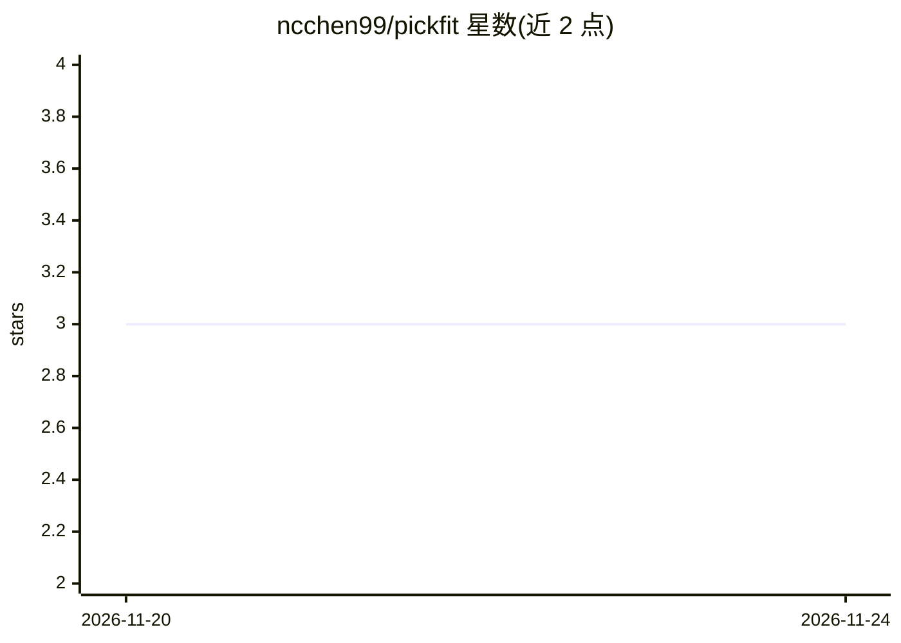

# ncchen99/pickfit

⭐ 3 · Python · MIT · 推送 2026-11-22 · [GitHub](https://github.com/ncchen99/pickfit) · [官网](https://pickfit.app) · 个人维护 · 中文 README

**为人和 AI agent 推荐并沙箱实测软件的工具顾问**

pickfit 读取开源项目，在全新沙箱中安装并验证功能，离线回放可用步骤，之后才将其纳入推荐目录；结果按需求匹配度排序而非星标数，覆盖 CLI 工具、本地 AI 工具、MCP 服务器、桌面应用与 Web 应用。以网站和无状态 MCP 服务器两种形式提供，提供 find_software、find_alternatives、get_install_guide、report_outcome、submit_software 五个工具调用，每条回答附带 how_we_know 与 evidence_url。自 2026 年 11 月 15 日起流程运行在 Anthropic Claude 上；期间曾使用 Meta Muse 系列模型。

## 筛选速览

| 维度 | 判定 | 备注 |
|---|---|---|
| AI 角色 | `ai-native` | 本体是模型或模型工具 |
| 许可风险 | `permissive` | MIT |
| 部署形态 | `None` |  |
| 模型依赖 | locked-api |  |
| 硬件要求 | — | 无带数字的原话,不猜 |
| 安装摩擦 | `low` | 无编译、无系统依赖或容器化 |
| 成熟度 | `idea` | |

## 能力要点

- 沙箱安装验证后仅推荐实测通过的工具，附证据链接
- MCP 服务器形式接入 agent，提供 5 个工具调用
- 目录含 1,154 个项目、159 个 hidden gems，英文与繁体中文网站
- 每个记录标注读取、运行与判定的模型名称

## 适用场景

- 让我的 agent 帮我找一台 Mac 上离线可用的会议转字幕工具并完成安装
- 为当前使用的工具寻找替代品，指定必须保留的特性
- 提交自己的开源项目，让它经过同样的安装与回放验证

## 场景标签

`推荐系统` · 领域:学习与行业

## 证据(README 行号)

> L6: A software advisor for people and their AI agents. pickfit installs and tests software in a sandbox before it recomm
> L43: **In your agent:** pickfit is a stateless MCP server at `https://pickfit.app/mcp`. No account needed.
> L57: |`find_software`|Two or three verified tools for a need and conditions (OS, CPU, free, offline), with reasons, trad

## 星数曲线

2026-11-20 3 → 2026-11-24 3（+0）

---
*卡片 v1 · prompt 1.4 · 生成 2026-11-21 · 置信度 high · 依据 README sha `3f4632279674` · [字段定义](../../DATASET.md)*
