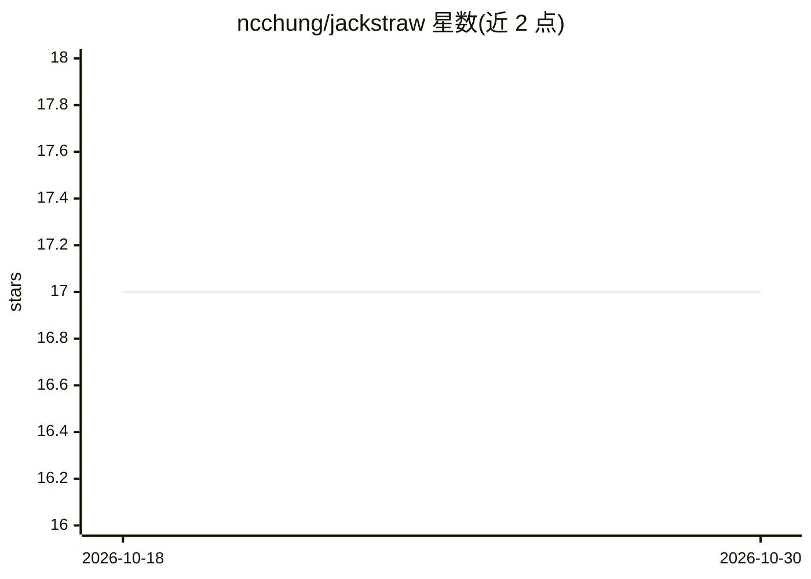

# ncchung/jackstraw

⭐ 17 · R · 推送 2026-04-07 · [GitHub](https://github.com/ncchung/jackstraw) · 个人维护

**R 包：对 PCA、聚类等无监督学习结果做统计显著性检验**

R 语言统计包，针对无监督学习中的循环分析问题提供重采样检验方案：对观测数据与其系统变异模式（潜变量）之间的关联做统计显著性推断。支持 PCA（含 IRLBA 截断与随机化 SVD）、因子分析、LFA、K-means、PAM、Mini Batch K-means 等方法的检验，另提供主成分/聚类数目估计与基于 p 值的后验包含概率计算。面向高维数据分析者（如微阵列、scRNA-seq、基因数据），论文发表于 Bioinformatics。稳定版在 CRAN，开发版经 GitHub 安装，部分函数需手动安装 Bioconductor 依赖。

## 筛选速览

| 维度 | 判定 | 备注 |
|---|---|---|
| AI 角色 | `ai-native` | 本体是模型或模型工具 |
| 许可风险 | `none` | — |
| 部署形态 | `None` |  |
| 模型依赖 | — | README 未给出锁定关系 |
| 硬件要求 | — | 无带数字的原话,不猜 |
| 安装摩擦 | `low` | 无编译、无系统依赖或容器化 |
| 成熟度 | — | 结构信号不足 |

## 能力要点

- jackstraw_pca/lfa/kmeans 等针对多种无监督方法的关联检验
- 重采样策略处理无监督学习中的过拟合与循环分析问题
- 支持截断 PCA（IRLBA）与随机化 SVD
- 基于 p 值估计后验包含概率（pip）

## 适用场景

- 找出与主成分显著相关的基因等变量
- 检验单细胞数据中聚类成员的显著性
- 对 SNP 数据做与群体结构的关联检验

## 场景标签

 · 领域:统计/生物信息学

## 证据(README 行号)

> L1: # jackstraw: Statistical Inference for Unsupervised Learning
> L3: This **R** package performs association tests between the observed data and their systematic patterns of variation. 
> L5: Using a variety of unsupervised learning techniques, the jackstraw provides a resampling strategy and testing scheme

## 星数曲线

2026-10-18 17 → 2026-10-30 17（+0）

---
*卡片 v1 · prompt 1.4 · 生成 2026-10-29 · 置信度 high · 依据 README sha `642c66d0d2d9` · [字段定义](../../DATASET.md)*
