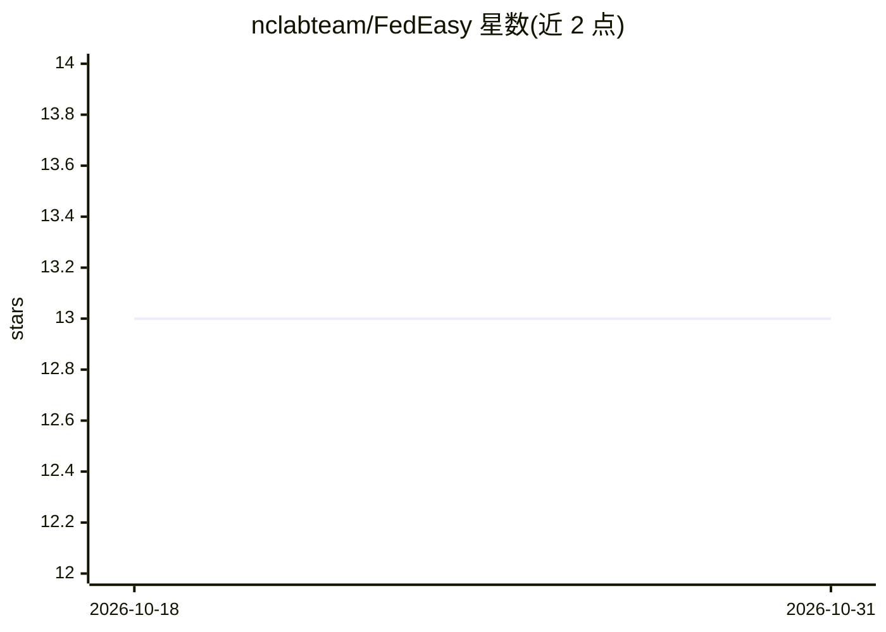

# nclabteam/FedEasy

⭐ 13 · Python · Apache-2.0 · 推送 2026-02-25 · [GitHub](https://github.com/nclabteam/FedEasy) · [官网](https://fedeasy.readthedocs.io/) · 组织维护

**供科研人员的联邦学习实验框架：单机模拟多客户端训练**

基于 Flower 与 PyTorch 构建的联邦学习实验框架，面向研究人员与开发者，用于简化联邦学习实验的搭建与运行。通过 config.yaml 分 common/server/client 三段配置，支持 7 种聚合策略（FedAvg、FedProx、FedAdam 等）、多种数据分布（IID、Dirichlet 非 IID）、多个数据集与 19 种模型架构，可在单机上以 Flower 模拟模式扩展到数百客户端，输出保存至 out 目录。代码在 Ubuntu 上编写测试，Windows 用户可能需要调整步骤；发表在 SoftwareX 期刊。

## 筛选速览

| 维度 | 判定 | 备注 |
|---|---|---|
| AI 角色 | `ai-ecosystem` | LLM/agent 周边工具 |
| 许可风险 | `permissive` | Apache-2.0 |
| 部署形态 | `library` | 以包/库形式分发 |
| 模型依赖 | — | README 未给出锁定关系 |
| 硬件要求 | — | 无带数字的原话,不猜 |
| 安装摩擦 | `low` | 无编译、无系统依赖或容器化 |
| 成熟度 | — | 结构信号不足 |

## 能力要点

- 单机模拟模式下可扩展到数百客户端
- 支持 7 种联邦学习策略（FedAvg/FedProx/FedAdam/FedLaw 等）
- config.yaml 统一配置数据分布、模型、优化器与资源分配
- 内置 19 种模型架构与 6 个数据集支持

## 适用场景

- 在单机上运行和对比联邦学习实验
- 研究非 IID 数据分布（Dirichlet）对联邦训练的影响
- 复现或扩展多种联邦聚合策略的实验

## 场景标签

`科研工具` · 领域:学习与行业

## 证据(README 行号)

> L5: FedEasy is an intuitive, powerful yet simple to use Federated Learning framework built on top of Flower and PyTorch 
> L61: 9. To scale clients to a few hundred, we can run Flower in simulation mode on a single machine like this:
> L97: - `strategy` : This field specifies the strategy used for Federated Learning. Currently supported strategies are [`

## 星数曲线

2026-10-18 13 → 2026-10-31 13（+0）

---
*卡片 v1 · prompt 1.4 · 生成 2026-10-31 · 置信度 mid · 依据 README sha `3d6e2a56b487` · [字段定义](../../DATASET.md)*
