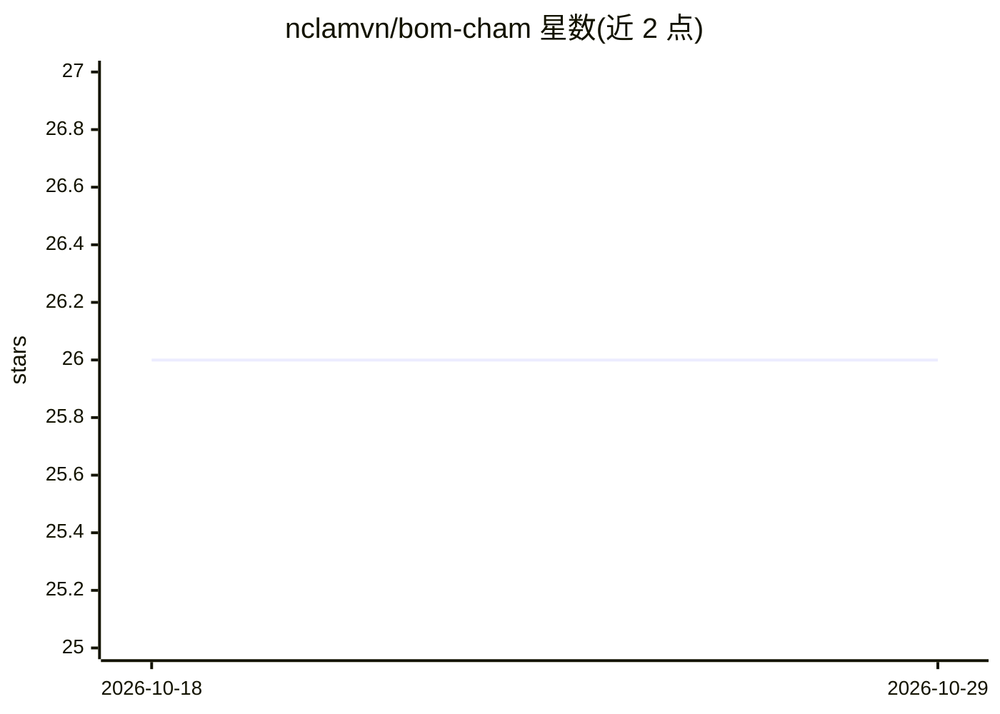

# nclamvn/bom-cham

⭐ 26 · TypeScript · MIT · 推送 2026-02-21 · [GitHub](https://github.com/nclamvn/bom-cham) · 个人维护

**面向居家老人照护的 AI 平台：传感监测、提醒与家庭告警**

Bờm Chăm 是越南语的家庭老人照护 AI 平台：接入 Home Assistant 与 Aqara FP2、mmWave、摄像头等传感器，提供 18 个技能，覆盖 24/7 监控与四级告警、跌倒检测、SOS、血压血糖记录、服药提醒（TTS+Zalo）、睡眠分析、每日报告等。告警通过 Zalo/Telegram/Viber 送达，家人用 Family PWA 查看状态；支持多位老人独立 profile，5 步向导完成初始化。以 Docker Compose 部署，需自备 Raspberry Pi 等硬件（约 1200 万越南盾）。

## 筛选速览

| 维度 | 判定 | 备注 |
|---|---|---|
| AI 角色 | `ai-native` | 本体是模型或模型工具 |
| 许可风险 | `permissive` | MIT |
| 部署形态 | `self-host` | docker 或自建部署 |
| 模型依赖 | local-ok | 支持本地模型 |
| 硬件要求 | — | 无带数字的原话,不猜 |
| 安装摩擦 | `low` | 无编译、无系统依赖或容器化 |
| 成熟度 | — | 结构信号不足 |

## 能力要点

- 18 个照护技能：24/7 监控、跌倒检测、SOS 三级、用药与睡眠管理
- 经 Zalo/Telegram/Viber 四通道通知家人
- Family PWA 与 5 步 Onboarding 向导，越南语大字体界面
- 支持多位老人独立 profile（传感器/联系人/用药分离）

## 适用场景

- 远程照看独居父母并实时接收跌倒或 SOS 告警
- 通过聊天记录老人血压血糖并提醒按时服药
- 家人用手机 PWA 查看老人状态与每日总结

## 场景标签

 · 领域:智能家居/老人照护

## 证据(README 行号)

> L9: Bờm Chăm là nền tảng AI chăm sóc người cao tuổi tại nhà. Tích hợp cảm biến,
> L30: |1|eldercare-monitor|Giám sát 24/7, 4 mức cảnh báo, kiểm tra mỗi 5 phút|
> L117: - **AI:** Claude / GPT-4o / Gemini / Ollama

## 星数曲线

2026-10-18 26 → 2026-10-29 26（+0）

---
*卡片 v1 · prompt 1.4 · 生成 2026-10-26 · 置信度 high · 依据 README sha `699748023a04` · [字段定义](../../DATASET.md)*
