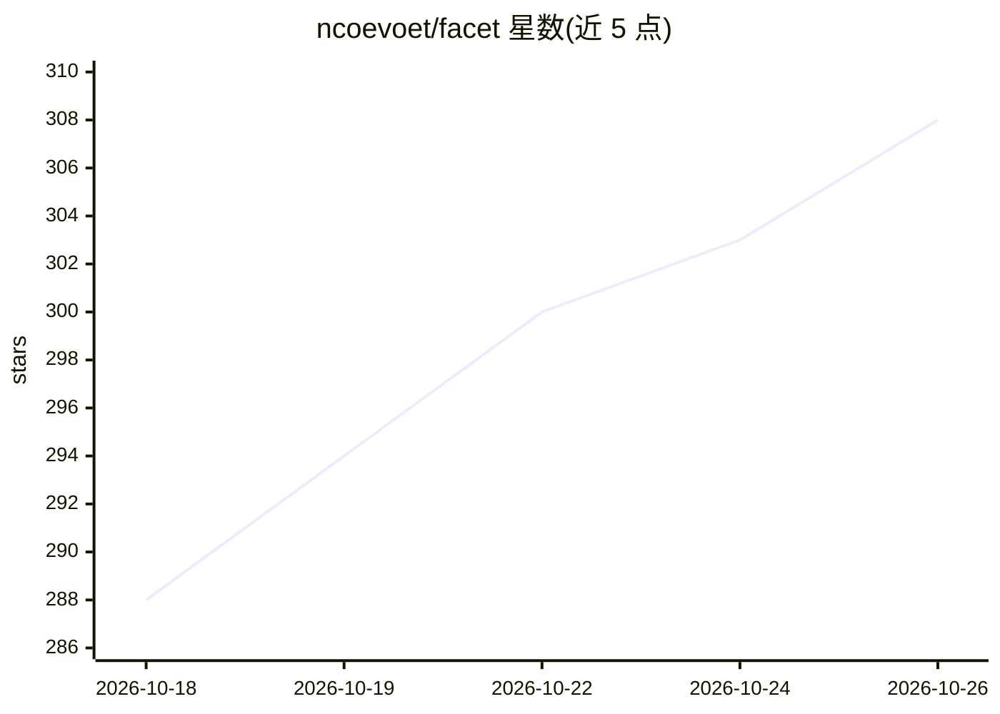

# ncoevoet/facet

⭐ 308 · Python · NOASSERTION · 推送 2026-10-25 · [GitHub](https://github.com/ncoevoet/facet) · [官网](https://ncoevoet.github.io/facet/) · 个人维护 · 中文 README

**本地照片 AI 评分与筛选引擎：评分、人脸识别、语义搜索**

本地运行的照片分析与筛选系统：对每张照片按美学、构图、面部质量等 9 个维度评分，支持 JPG/RAW/HEIF 等格式解析；提供 Web 画廊浏览、连拍检测、眨眼标记、相似照片分组与一键自动筛选；人脸识别可聚类与合并人物，语义搜索用自然语言找图，另有时间线、地图、统计看板与 AI 评语/描述（部分功能标注 Edition 或 GPU/显存要求）。全部在本机运行，无需云端账号或 API key。后端 FastAPI，前端 Angular。

## 筛选速览

| 维度 | 判定 | 备注 |
|---|---|---|
| AI 角色 | `ai-native` | 本体是模型或模型工具 |
| 许可风险 | `none` | NOASSERTION |
| 部署形态 | `self-host` | docker 或自建部署 |
| 模型依赖 | — | README 未给出锁定关系 |
| 硬件要求 | `gpu-24g` | |
| 安装摩擦 | `low` | 无编译、无系统依赖或容器化 |
| 成熟度 | — | 结构信号不足 |

## 能力要点

- 9 维度照片评分与 30+ 内容类别的加权分类
- 连拍/包围曝光/全景序列检测与一键自动筛选
- 人脸检测、人物聚类与眨眼标记
- 自然语言语义搜索与地理地图浏览

## 适用场景

- 摄影师从大批照片中快速选出最佳照片
- 按人物、场景、内容标签整理本地照片库
- 向客户发送选片链接进行确认与评论

## 场景标签

`语义搜索` `人脸识别` `图像视频处理` · 领域:知识与检索

## 证据(README 行号)

> L5: Facet is a local photo-analysis and culling engine. It scores each image across 9 dimensions — from aesthetic qualit
> L17: 1. **Scan** — Point Facet at a folder of photos. Each image is analyzed for quality, composition, and faces. Suppor
> L27: Each photo is scored across 9 dimensions: aesthetic quality, composition, face quality, eye sharpness, technical sh

## 星数曲线

2026-10-18 288 → 2026-10-26 308（+20）

---
*卡片 v1 · prompt 1.4 · 生成 2026-10-21 · 置信度 high · 依据 README sha `c247d3708464` · [字段定义](../../DATASET.md)*
