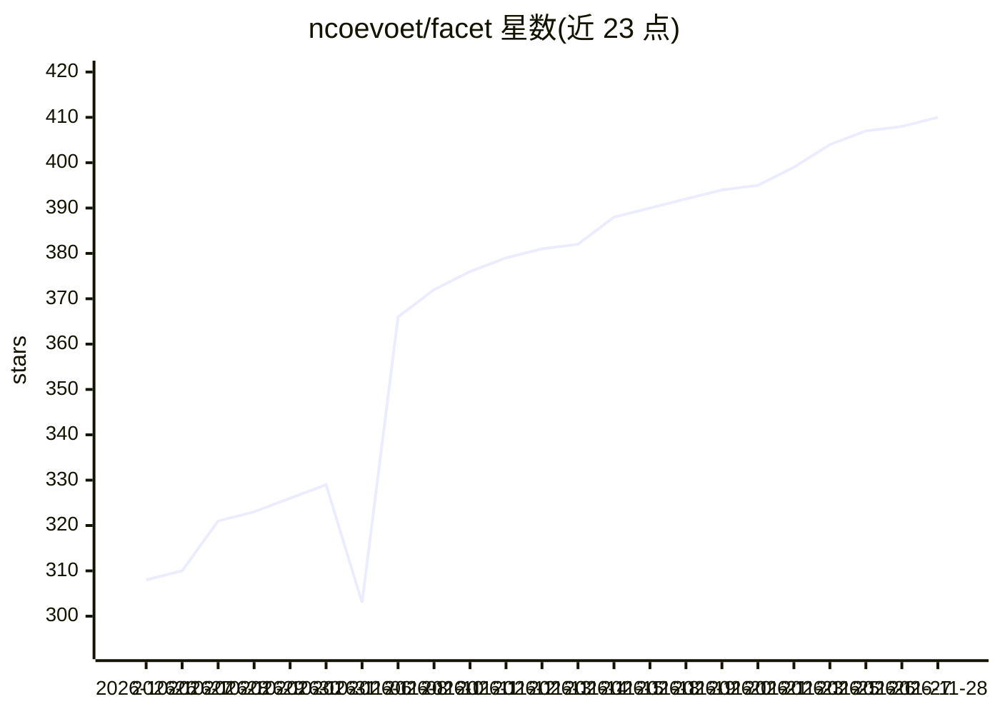

# ncoevoet/facet

⭐ 410 · Python · NOASSERTION · 推送 2026-11-27 · [GitHub](https://github.com/ncoevoet/facet) · [官网](https://ncoevoet.github.io/facet/) · 个人维护

**本地照片打分与选片引擎：评分、整理并浏览照片库**

Facet 是本地运行的照片分析与选片引擎：对每张照片在9个维度打分（美学质量、人脸清晰度等），通过 Web 画廊浏览、筛选与整理。核心机制包括连拍检测、闭眼检测、相似照片分组、人脸识别聚类、语义搜索与自动选片，支持从标签学习个性化权重。全部在本机运行，无云端与 API key；可选 GPU 解锁 VLM 标注与 AI 描述等更强模型。

## 筛选速览

| 维度 | 判定 | 备注 |
|---|---|---|
| AI 角色 | `ai-native` | 本体是模型或模型工具 |
| 许可风险 | `none` | NOASSERTION |
| 部署形态 | `self-host` | docker 或自建部署 |
| 模型依赖 | local-ok | 支持本地模型 |
| 硬件要求 | — | 无带数字的原话,不猜 |
| 安装摩擦 | `low` | 无编译、无系统依赖或容器化 |
| 成熟度 | — | 结构信号不足 |

## 能力要点

- 9 维度照片评分与 30+ 内容类别加权打分
- 连拍/闭眼/重复检测与相似分组的一键自动选片
- 人脸识别聚类、语义搜索与自然语言查图
- MCP 端点允许 AI 助手搜索与管理照片库

## 适用场景

- 大容量本地照片库中挑选最佳照片、剔除连拍废片
- 按人脸或语义关键词整理和检索私人照片
- 自托管画廊向客户分享选片与校样

## 场景标签

`语义搜索` `人脸识别` · 领域:知识与检索

## 证据(README 行号)

> L5: Facet is a local photo-analysis and culling engine. It scores each image across 9 dimensions — from aesthetic qualit
> L56: - **Semantic search** — type a natural-language query like "sunset on the beach" and find matching photos via embed
> L78: - **Face recognition** — automatic face detection, grouping into persons, and blink detection. Search, rename, merg

## 星数曲线

2026-10-26 308 → 2026-11-28 410（+102）

---
*卡片 v1 · prompt 1.4 · 生成 2026-11-28 · 置信度 high · 依据 README sha `21f973985ae1` · [字段定义](../../DATASET.md)*
