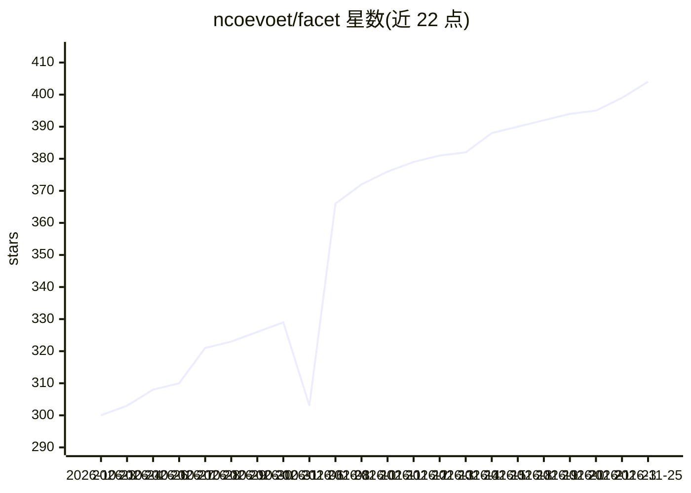

# ncoevoet/facet

⭐ 404 · Python · NOASSERTION · 推送 2026-11-23 · [GitHub](https://github.com/ncoevoet/facet) · [官网](https://ncoevoet.github.io/facet/) · 个人维护

**本地照片评分与选片引擎：打分、筛选并建立人脸/语义检索图库**

Facet 是本地运行的照片分析与选片引擎：对每张照片按审美质量、构图、人脸质量、清晰度等 9 个维度打分，按 30+ 内容类别加权；检测连拍、闭眼、相似照片与重复图，支持一键 auto-cull、终端命令行选片，并识别包围曝光/全景/HDR 序列整组保留。提供 Web 图库（滤镜、语义搜索、时间线、地图）、人脸识别分组、相册管理与评分，以及分享链接、客户选片校样、MCP 端点。全部在本机运行，无云端、账号或 API key；GPU 可选，无 GPU 时可指向远程 vlm_backend。

## 筛选速览

| 维度 | 判定 | 备注 |
|---|---|---|
| AI 角色 | `ai-native` | 本体是模型或模型工具 |
| 许可风险 | `none` | NOASSERTION |
| 部署形态 | `self-host` | docker 或自建部署 |
| 模型依赖 | local-ok | 支持本地模型 |
| 硬件要求 | `gpu-24g` | |
| 安装摩擦 | `low` | 无编译、无系统依赖或容器化 |
| 成熟度 | — | 结构信号不足 |

## 能力要点

- 9 维度照片评分与按类别的权重调节，可从 A/B 比较学习个人偏好
- 连拍/相似/闭眼/重复检测与带 dry-run 预览的 auto-cull
- 语义搜索（"sunset on the beach"）与人脸识别分组管理
- 零样本杂物清扫（截图/文档/表情包）与零样本场景标签

## 适用场景

- 从大量本地照片中筛选最佳照片并剔除连拍废片
- 自建无人脸云服务的人脸分组与语义检索照片库
- 通过分享链接让客户对选片进行标记与评论
- 用 Ollama/OpenAI 兼容后端补充 VLM 打标与说明生成

## 场景标签

`语义搜索` `人脸识别` `图像视频处理` · 领域:知识与检索

## 证据(README 行号)

> L5: Facet is a local photo-analysis and culling engine. It scores each image across 9 dimensions — from aesthetic qualit
> L27: Each photo is scored across 9 dimensions: aesthetic quality, composition, face quality, eye sharpness, technical sh
> L147: - **No GPU?** Point VLM tagging, captions and critique at a remote **Ollama** or **OpenAI-compatible** server with

## 星数曲线

2026-10-23 300 → 2026-11-25 404（+104）

---
*卡片 v1 · prompt 1.4 · 生成 2026-11-25 · 置信度 high · 依据 README sha `f594f2f40960` · [字段定义](../../DATASET.md)*
