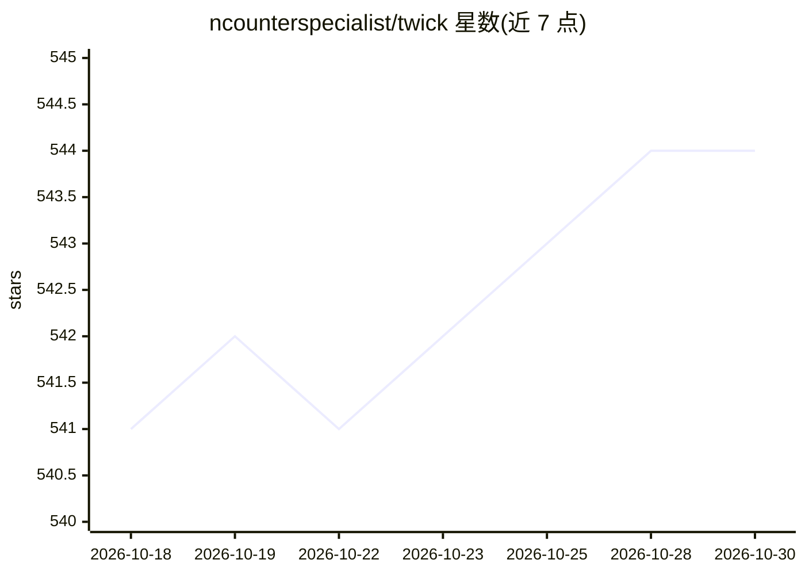

# ncounterspecialist/twick

⭐ 544 · TypeScript · NOASSERTION · 推送 2026-06-04 · [GitHub](https://github.com/ncounterspecialist/twick) · [官网](https://ncounterspecialist.github.io/twick/) · 组织维护

**面向开发者的 React 视频编辑器 SDK，含 AI 字幕与 MP4 导出**

模块化的 React 视频编辑库与云工具链：提供时间线编辑器、基于 Fabric.js 的画布工具、GL 着色器视频特效、WebCodecs 浏览器端渲染与 Node/Puppeteer/FFmpeg 服务端渲染两条 MP4 导出路径，另有 AWS Lambda 容器的无服务器导出与云函数包。AI 能力为字幕/转录生成（使用 Google Vertex AI/Gemini），并含面向 Claude Desktop 的 MCP agent 包。面向 React 前端工程师、AI/ML 团队与产品团队构建视频类应用；不面向寻求现成消费级编辑器的非技术用户。要求 Node >= 20、pnpm 8.x；浏览器端导出仅支持 WebCodecs（Chrome/Edge），Firefox/Safari 需走服务端导出。

## 筛选速览

| 维度 | 判定 | 备注 |
|---|---|---|
| AI 角色 | `ai-enhanced` | 去掉 AI 部分产品仍成立 |
| 许可风险 | `none` | NOASSERTION |
| 部署形态 | `library` | 以包/库形式分发 |
| 模型依赖 | locked-api |  |
| 硬件要求 | — | 无带数字的原话,不猜 |
| 安装摩擦 | `medium` | 含编译或系统依赖之一 |
| 成熟度 | — | 结构信号不足 |

## 能力要点

- 时间线/画布/播放器等模块化 React 组件包，可组装自定义编辑器
- AI 字幕与转录生成（Google Vertex AI/Gemini）及从视频 URL 自动生成字幕项目
- 浏览器端 WebCodecs + FFmpeg.wasm 渲染与服务端 Puppeteer + FFmpeg 渲染两条导出路径
- GL 着色器视频特效与 AWS Lambda 无服务器 MP4 导出

## 适用场景

- 在 SaaS 或内部工具中快速嵌入完整视频编辑器（Twick Studio）
- 自组装编辑器 UI 并深度定制时间线与画布
- 构建无 UI 的批量渲染与自动化视频流水线
- 为视频自动生成带时间轴的 AI 字幕

## 场景标签

`图像视频处理` `语音识别` · 领域:感知与多模态

## 证据(README 行号)

> L34: **Twick** is an open-source **React Video Editor Library & SDK** featuring AI caption generation, timeline editing,
> L39: - AI caption generation
> L130: - **`@twick/studio`** – All-in-one, production-ready React video editor UI

## 星数曲线

2026-10-18 541 → 2026-10-30 544（+3）

---
*卡片 v1 · prompt 1.4 · 生成 2026-10-21 · 置信度 high · 依据 README sha `86607edaf266` · [字段定义](../../DATASET.md)*
