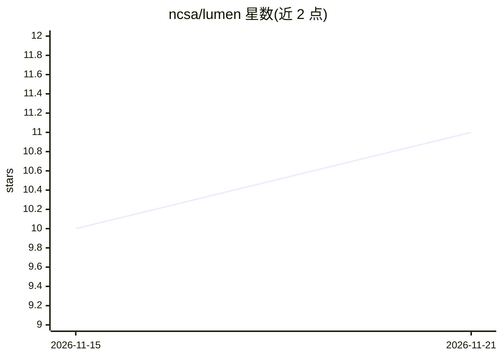

# ncsa/lumen

⭐ 11 · Python · Apache-2.0 · 推送 2026-11-20 · [GitHub](https://github.com/ncsa/lumen) · 组织维护

**自托管 AI 网关：机构统一管理模型访问与用量配额**

自托管的 AI 网关，提供 Web 聊天界面和 OpenAI 兼容 API 代理，管理员可控制谁能访问哪些模型、每个用户/组的 token 预算（coin 池机制）。支持每个模型指向多个后端端点并做 round-robin 负载均衡与健康跳过；通过 CILogon 对接机构身份联合登录，可按机构主题定制界面。提供管理员面板、Prometheus 指标、基于所有权的模型访问控制。数据库迁移仅支持 PostgreSQL，本地开发可用 SQLite 建表。

## 筛选速览

| 维度 | 判定 | 备注 |
|---|---|---|
| AI 角色 | `ai-ecosystem` | LLM/agent 周边工具 |
| 许可风险 | `permissive` | Apache-2.0 |
| 部署形态 | `self-host` | docker 或自建部署 |
| 模型依赖 | local-ok | 支持本地模型 |
| 硬件要求 | — | 无带数字的原话,不猜 |
| 安装摩擦 | `low` | 无编译、无系统依赖或容器化 |
| 成熟度 | — | 结构信号不足 |

## 能力要点

- OpenAI 兼容 API 代理，含 Anthropic Messages API 子集（/v1/messages）
- 每模型多后端端点 round-robin 负载均衡并跳过不健康节点
- 基于用户/组/项目的 coin 预算与按所有权模型访问控制
- CILogon 机构联合登录与登录时自动分组规则

## 适用场景

- 机构内部统一提供模型访问入口并控制配额
- 将多个模型后端聚合为一个 OpenAI 兼容端点
- 按研究机构属性自动分配用户到不同额度组

## 场景标签

`模型网关` `聊天机器人` · 领域:Agent 开发

## 证据(README 行号)

> L3: Lumen is a self-hosted AI gateway. It provides a web chat interface and an OpenAI-compatible API proxy, while giving
> L7: - OpenAI-compatible API proxy — use Lumen as a drop-in endpoint from any tool or script

## 星数曲线

2026-11-15 10 → 2026-11-21 11（+1）

---
*卡片 v1 · prompt 1.4 · 生成 2026-11-19 · 置信度 high · 依据 README sha `5bf2d968b4a6` · [字段定义](../../DATASET.md)*
