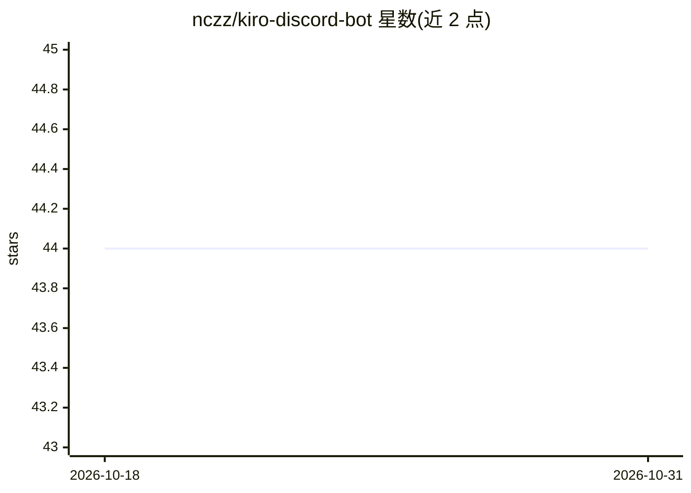

# nczz/kiro-discord-bot

⭐ 44 · Go · MIT · 推送 2026-10-30 · [GitHub](https://github.com/nczz/kiro-discord-bot) · [官网](https://nczz.github.io/kiro-discord-bot/) · 个人维护

**把 Discord 频道接入项目绑定 ACP 编程代理的控制平面**

用 Go 编写的 Discord 机器人与控制平面：通过 stdio 连接 ACP 兼容的编码代理，默认引擎为 Kiro CLI，可按频道/线程切换 OMP。每个频道绑定一个项目目录、拥有独立代理会话与记忆/steering 上下文；MCP 服务器以目录形式发现并经频道策略与代理暴露；提供 cron 定时任务、审计/用量记录、Discord Gateway 看门狗自动重连。代理引擎本身（安装、认证、模型访问）由各自项目维护，本产品只负责启动与控制。

## 筛选速览

| 维度 | 判定 | 备注 |
|---|---|---|
| AI 角色 | `ai-ecosystem` | LLM/agent 周边工具 |
| 许可风险 | `permissive` | MIT |
| 部署形态 | `None` |  |
| 模型依赖 | — | README 未给出锁定关系 |
| 硬件要求 | — | 无带数字的原话,不猜 |
| 安装摩擦 | `low` | 无编译、无系统依赖或容器化 |
| 成熟度 | — | 结构信号不足 |

## 能力要点

- 每个 Discord 频道绑定项目目录与独立代理会话
- Kiro CLI 默认引擎，OMP 可按频道/线程替换
- MCP 工具经频道策略与代理受控暴露
- cron 定时任务与审计、用量记录；Gateway 看门狗自动重连

## 适用场景

- 在 Discord 里让编程代理操作指定项目目录
- 按频道策略控制代理可用的 MCP 工具
- 让代理执行定时任务并保留审计记录

## 场景标签

`编码 Agent` · 领域:编码与开发

## 证据(README 行号)

> L5: **A Discord bot and control plane for project-bound ACP agents.**
> L7: `kiro-discord-bot` connects Discord channels and threads to ACP-compatible coding agents over stdio. Kiro CLI is the
> L15: Kiro CLI and OMP are external agent CLIs. This project starts and controls them from Discord, but their installatio

## 星数曲线

2026-10-18 44 → 2026-10-31 44（+0）

---
*卡片 v1 · prompt 1.4 · 生成 2026-10-25 · 置信度 high · 依据 README sha `4a86c3771053` · [字段定义](../../DATASET.md)*
