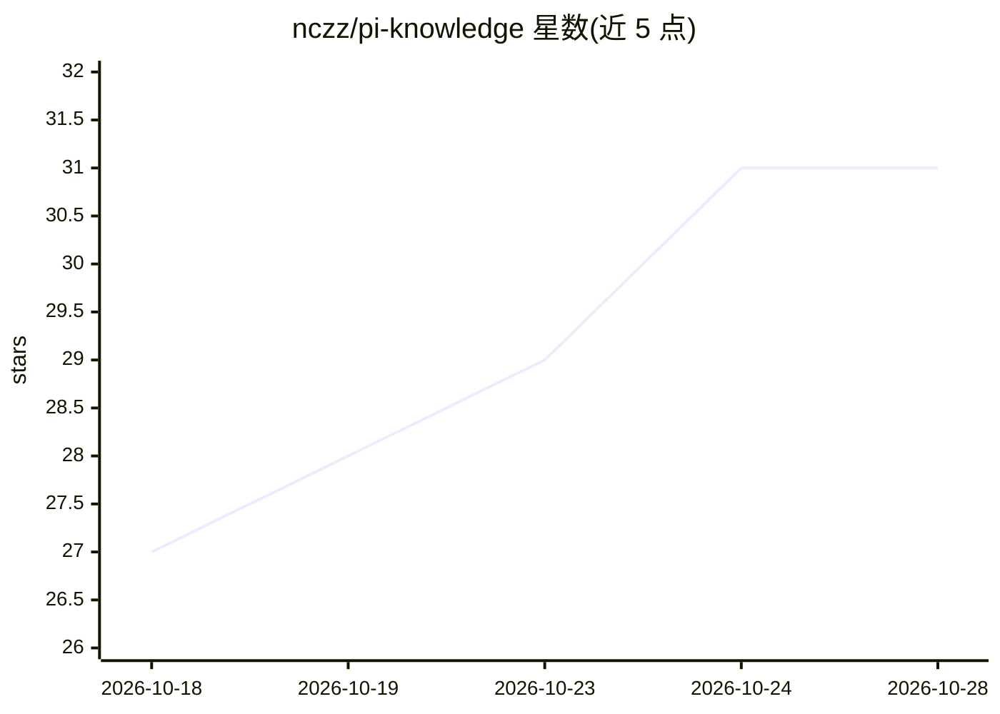

# nczz/pi-knowledge

⭐ 31 · TypeScript · MIT · 推送 2026-10-19 · [GitHub](https://github.com/nczz/pi-knowledge) · [官网](https://www.npmjs.com/package/pi-knowledge) · 个人维护

**给 Pi/OMP 编程 agent 的本地优先 RAG 知识库**

Pi 原生扩展（兼容 OMP）的本地优先知识库工具：将代码库、文档、PDF、URL、笔记索引为持久化知识库，供编程 agent 跨会话检索。机制包括 BM25+向量加权融合的混合检索、AST 代码感知分块、可选 cross-encoder 重排、多级符号/配置/标题精确查找、增量重索引、索引诊断（knowledge_doctor）与大项目持久化进度。本地嵌入无需 API key，索引存于 ~/.pi/knowledge/。提供 12 个 agent 工具与多种检索模式（fast/semantic/hybrid/adaptive/deep 等）。限制：TUI 自定义渲染尚未启用。

## 筛选速览

| 维度 | 判定 | 备注 |
|---|---|---|
| AI 角色 | `ai-ecosystem` | LLM/agent 周边工具 |
| 许可风险 | `permissive` | MIT |
| 部署形态 | `desktop` | 安装包/桌面程序 |
| 模型依赖 | — | README 未给出锁定关系 |
| 硬件要求 | — | 无带数字的原话,不猜 |
| 安装摩擦 | `low` | 无编译、无系统依赖或容器化 |
| 成熟度 | — | 结构信号不足 |

## 能力要点

- BM25+语义向量归一化加权融合的混合检索与 7 种检索模式
- AST 代码感知分块（TS/JS/Py/Go/Rust/Java 等）与符号/配置项精确查找
- 本地嵌入无需 API key，索引数据默认保存在本机
- 增量重索引、索引诊断与大规模项目持久化进度管理

## 适用场景

- 让编程 agent 跨会话记住并检索我的项目代码与文档
- 在本地私有地索引代码库，不把源码发给外部服务
- 大仓库索引时避免静默卡死，并诊断过期或劣质索引

## 场景标签

`RAG` `Agent 记忆` · 领域:Agent 开发

## 证据(README 行号)

> L3: Local-first RAG knowledge base for Pi and OMP coding agents.
> L7: Built as a native Pi extension with verified OMP compatibility through the packaged extension entry. Designed for lo
> L5: Index your codebase, docs, PDFs, URLs, and notes into persistent knowledge bases that Pi and OMP can search across s

## 星数曲线

2026-10-18 27 → 2026-10-28 31（+4）

---
*卡片 v1 · prompt 1.4 · 生成 2026-10-26 · 置信度 high · 依据 README sha `f6b484e2e345` · [字段定义](../../DATASET.md)*
