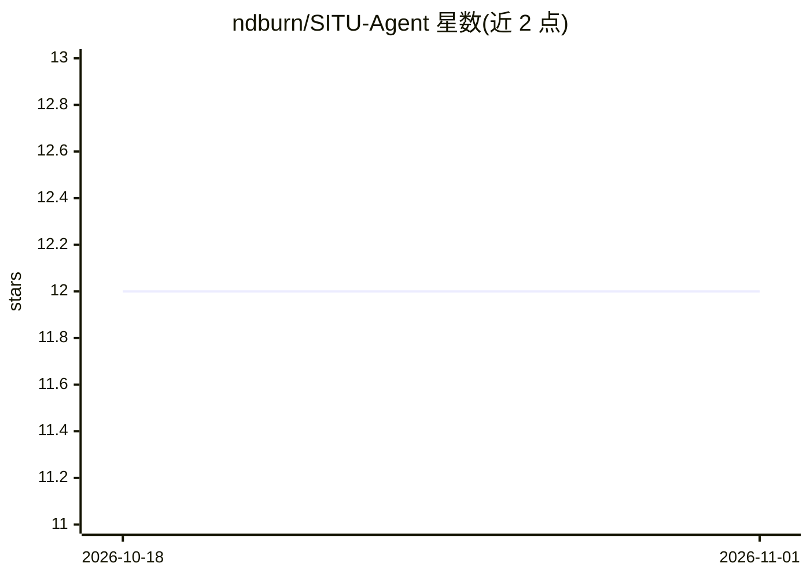

# ndburn/SITU-Agent

⭐ 12 · Shell · MIT · 推送 2026-06-22 · [GitHub](https://github.com/ndburn/SITU-Agent) · [官网](https://situagent.com/) · 个人维护

**网络隔离的本地 AI 编程 agent，运行于 Podman 容器**

以 Podman pod 运行的开源 AI 编程代理，容器置于无外部路由的内部网络（--network=none 由内核强制），不联网、无遥测，模型与代码均留在本机。支持任意 OpenAI 兼容模型（Gemma、Llama、Mistral、Qwen），提供 RESTRICTED 全隔离与 NETWORK 指向外部 LM 服务器两种模式，可用 --test 验证隔离是否生效（检查 HTTP/HTTPS/DNS/原始 TCP 是否被阻断）。面向代码不可上云的开发者：金融、国防、法律、生物、医疗、政府及受 NDA/出口管制约束的团队。MIT 许可。

## 筛选速览

| 维度 | 判定 | 备注 |
|---|---|---|
| AI 角色 | `ai-native` | 本体是模型或模型工具 |
| 许可风险 | `permissive` | MIT |
| 部署形态 | `None` |  |
| 模型依赖 | — | README 未给出锁定关系 |
| 硬件要求 | — | 无带数字的原话,不猜 |
| 安装摩擦 | `low` | 无编译、无系统依赖或容器化 |
| 成熟度 | — | 结构信号不足 |

## 能力要点

- 容器运行于无外部路由的内部网络，内核级强制隔离
- 模型无关：接入任意 OpenAI 兼容模型
- RESTRICTED/NETWORK 双模式
- --test 命令验证隔离与外部流量阻断

## 适用场景

- 在涉密或合规受限环境中本地运行 AI 编程助手
- 验证 agent 容器确实无法对外联网
- 配合自托管 LLM 服务器做离线编程辅助

## 场景标签

`编码 Agent` · 领域:编码与开发

## 证据(README 行号)

> L5: **An open-source AI agent that runs entirely on your hardware, in an isolated environment, with no network access. C
> L31: |**Model-Agnostic**|Drop in any OpenAI-compatible model: Gemma, Llama, Mistral, Qwen|

## 星数曲线

2026-10-18 12 → 2026-11-01 12（+0）

---
*卡片 v1 · prompt 1.4 · 生成 2026-11-01 · 置信度 high · 依据 README sha `08a0229488c1` · [字段定义](../../DATASET.md)*
