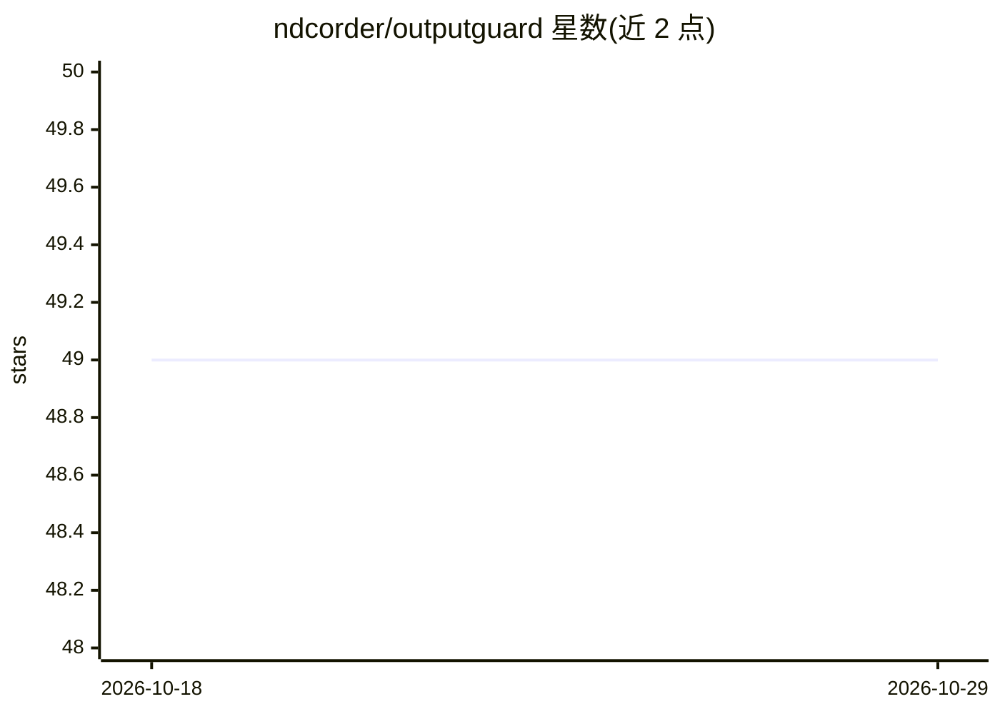

# ndcorder/outputguard

⭐ 49 · Python · MIT · 推送 2026-08-03 · [GitHub](https://github.com/ndcorder/outputguard) · [官网](https://github.com/ndcorder/outputguard) · 个人维护

**校验、修复并重试 LLM 结构化输出的 Python 库与 CLI**

面向开发者的 LLM 输出治理工具：对模型返回的 JSON/YAML/TOML/Python 字面量等做 JSON Schema 校验，应用 15 种修复策略处理常见格式破损（markdown 围栏、尾逗号、引号错误等），校验失败时生成针对性的重试提示词回传 LLM；guarded_generate() 封装完整校验-修复-重试循环。支持批量处理、RepairReport 可观测性报告与置信度评分。以 pip 包与 CLI 形式提供，与任意 LLM 提供方搭配使用，本身不调用模型。

## 筛选速览

| 维度 | 判定 | 备注 |
|---|---|---|
| AI 角色 | `ai-ecosystem` | LLM/agent 周边工具 |
| 许可风险 | `permissive` | MIT |
| 部署形态 | `library` | 以包/库形式分发 |
| 模型依赖 | — | README 未给出锁定关系 |
| 硬件要求 | — | 无带数字的原话,不猜 |
| 安装摩擦 | `low` | 无编译、无系统依赖或容器化 |
| 成熟度 | — | 结构信号不足 |

## 能力要点

- 15 种修复策略处理常见结构化输出破损
- JSON Schema 校验与生成针对性重试提示词的重试循环
- 支持 JSON/YAML/TOML/Python 字面量/自动检测格式
- 提供 CLI（validate/repair/batch/retry-prompt）与 RepairReport 可观测性报告

## 适用场景

- LLM 应用中自动修复破损的 JSON 输出再入库
- 为结构化输出流程加上校验失败后的自动重试
- 批量校验与修复模型输出并统计结果

## 场景标签

 · 领域:LLM 基础设施/输出校验

## 证据(README 行号)

> L23: result = outputguard.validate_and_repair(llm_output, schema)
> L121: `guarded_generate()` validates each generation, repairs when possible, feeds targeted retry prompts back to the ge

## 星数曲线

2026-10-18 49 → 2026-10-29 49（+0）

---
*卡片 v1 · prompt 1.4 · 生成 2026-10-24 · 置信度 high · 依据 README sha `28a747aa4471` · [字段定义](../../DATASET.md)*
