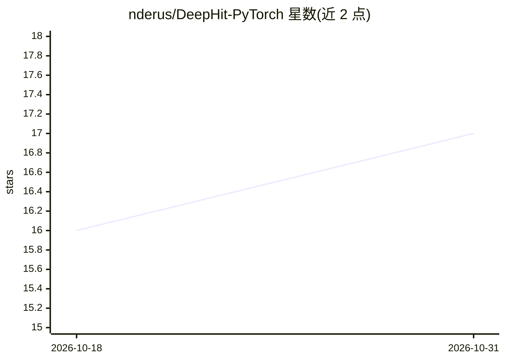

# nderus/DeepHit-PyTorch

⭐ 17 · Python · MIT · 推送 2026-07-02 · [GitHub](https://github.com/nderus/DeepHit-PyTorch) · 个人维护

**DeepHit 生存分析模型的 PyTorch 非官方实现**

Lee 等人 DeepHit 模型的 PyTorch 移植版：深度神经网络处理带竞争风险的生存分析，直接学习事件类型与离散事件时间的联合分布，从中读出原因别累积发生率函数。架构、损失与评测协议对应原 TensorFlow 实现，仅修正了原版特征标准化的数据泄漏问题。随附 SYNTHETIC 与 METABRIC 两个示例数据集、随机超参搜索脚本与加权 C-index/Brier 汇总脚本，附复现结果表。通过 conda 环境文件或 requirements.txt 安装，MIT 许可。

## 筛选速览

| 维度 | 判定 | 备注 |
|---|---|---|
| AI 角色 | `ai-native` | 本体是模型或模型工具 |
| 许可风险 | `permissive` | MIT |
| 部署形态 | `library` | 以包/库形式分发 |
| 模型依赖 | — | README 未给出锁定关系 |
| 硬件要求 | — | 无带数字的原话,不猜 |
| 安装摩擦 | `low` | 无编译、无系统依赖或容器化 |
| 成熟度 | — | 结构信号不足 |

## 能力要点

- 处理竞争风险的生存分析神经网络，学习事件类型与时间的联合分布
- 输出原因别累积发生率函数与时间依赖 C-index 评测
- 修正上游特征标准化的数据泄漏问题（仅用训练集拟合）
- 随附 SYNTHETIC/METABRIC 示例数据集与随机超参搜索流程

## 适用场景

- 我在做带竞争风险的临床/生存分析建模，需要 DeepHit 的 PyTorch 版本
- 我想复现或验证 DeepHit 论文的评测协议与结果
- 我需要从模型输出原因别累积发生率函数

## 场景标签

 · 领域:机器学习/生存分析

## 证据(README 行号)

> L9: An unofficial PyTorch port of **DeepHit**, a deep neural network for survival
> L11: assumptions about the underlying stochastic process. The model directly learns

## 星数曲线

2026-10-18 16 → 2026-10-31 17（+1）

---
*卡片 v1 · prompt 1.4 · 生成 2026-10-30 · 置信度 mid · 依据 README sha `05dfe4b93a7d` · [字段定义](../../DATASET.md)*
