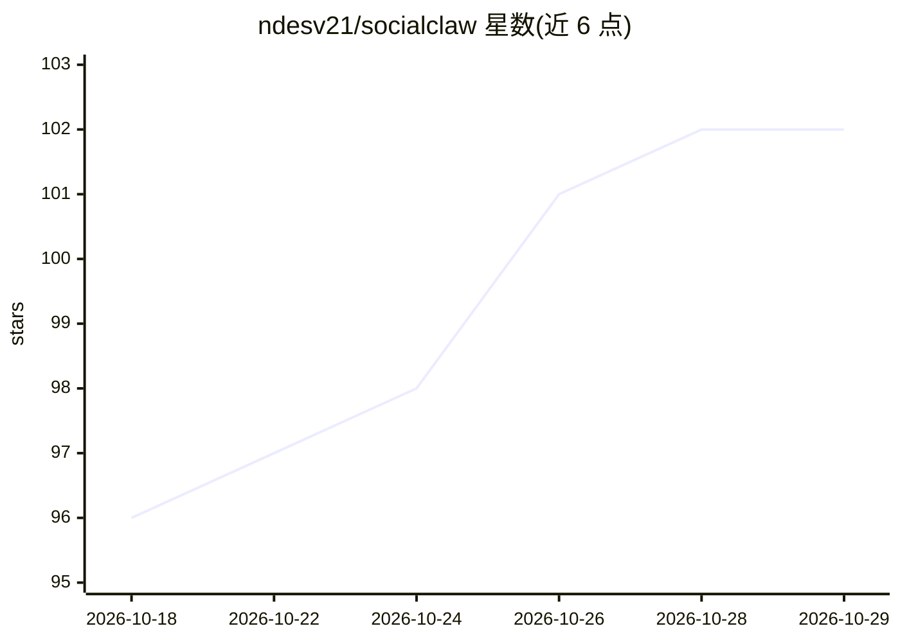

# ndesv21/socialclaw

⭐ 102 · JavaScript · MIT · 推送 2026-10-12 · [GitHub](https://github.com/ndesv21/socialclaw) · [官网](https://getsocialclaw.com) · 个人维护

**供 AI agent 调度的社媒发布 CLI 与技能包**

SocialClaw 是一个 npm CLI 与 OpenClaw 技能包，连接到其托管服务 getsocialclaw.com，将提示词、工作流与 AI agent 转化为跨 X、LinkedIn、Instagram、TikTok、Discord、Telegram、YouTube、Reddit、WordPress、Pinterest 等 12 类渠道的定时发布。提供账号连接、素材上传、排期校验/预览/应用、发布后检查与分析等命令；内置 MCP server（17 个工具）、Claude Code 插件与斜杠命令、OpenClaw 技能束。限制：需工作区 API key 且工作区须有试用或付费计划方可执行 agent 命令。

## 筛选速览

| 维度 | 判定 | 备注 |
|---|---|---|
| AI 角色 | `ai-ecosystem` | LLM/agent 周边工具 |
| 许可风险 | `permissive` | MIT |
| 部署形态 | `library` | 以包/库形式分发 |
| 模型依赖 | locked-api |  |
| 硬件要求 | — | 无带数字的原话,不猜 |
| 安装摩擦 | `low` | 无编译、无系统依赖或容器化 |
| 成熟度 | — | 结构信号不足 |

## 能力要点

- npm CLI 覆盖账号、素材、排期校验/应用/检查/分析与删除
- 内置 MCP server，向任意 MCP 客户端提供 17 个发布工具
- 提供 Claude Code 插件、/socialclaw 命令与 OpenClaw/ClawHub 技能束
- 支持 12 类社媒渠道的定时发布与幂等应用

## 适用场景

- 让 AI agent 代表我连接社媒账号并定时发布内容
- 通过 Claude Code 或其他 MCP 客户端管理多平台发布与分析
- 为自定义 agent 提供统一的社媒发布接口

## 场景标签

 · 领域:社媒发布自动化/Agent 工具

## 证据(README 行号)

> L5:  Social media scheduling CLI and OpenClaw skill for AI agents posting to X, LinkedIn, Instagram, Facebook Pages, Tik
> L74: ## Built for Agent-Driven Publishing
> L106: The package ships a Model Context Protocol server. Any MCP client (Claude Code, Claude Desktop, Cursor, and others

## 星数曲线

2026-10-18 96 → 2026-10-29 102（+6）

---
*卡片 v1 · prompt 1.4 · 生成 2026-10-23 · 置信度 high · 依据 README sha `7140fa02052e` · [字段定义](../../DATASET.md)*
