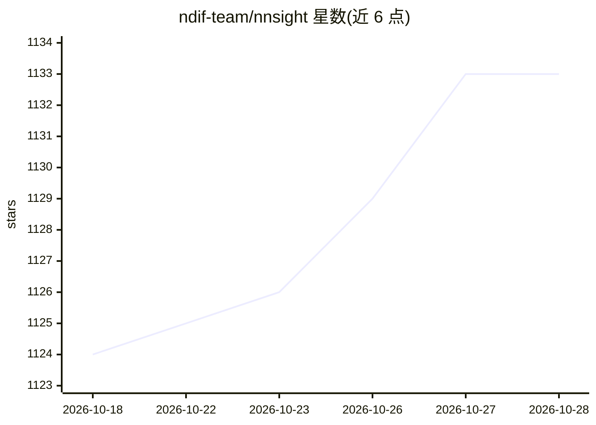

# ndif-team/nnsight

⭐ 1,133 · Python · MIT · 推送 2026-10-27 · [GitHub](https://github.com/ndif-team/nnsight) · [官网](https://nnsight.net/) · 组织维护

**给科研者：追踪并干预 PyTorch 模型内部机制的库**

nnsight 是一个 Python 库，让研究者在模型前向传播中读写任意内部值：通过 `with model.trace(...)` 块以普通 Python 描述对层输出、注意力模式、梯度的干预，无需注册 hook 或重构模型，干预与真实前向传播交错执行。兼容任意 torch.nn.Module，并为 HuggingFace、diffusers、vLLM 提供封装。设置 remote=True 时同一 trace 可通过 NDIF 基础设施在本地无法承载的大模型上运行（需 NDIF API key）。还支持生成逐步干预、多 prompt 批处理、梯度提取、logit lens、持久 edit()/skip() 等。主要面向可解释性研究人员。

## 筛选速览

| 维度 | 判定 | 备注 |
|---|---|---|
| AI 角色 | `ai-ecosystem` | LLM/agent 周边工具 |
| 许可风险 | `permissive` | MIT |
| 部署形态 | `library` | 以包/库形式分发 |
| 模型依赖 | local-ok | 支持本地模型 |
| 硬件要求 | — | 无带数字的原话,不猜 |
| 安装摩擦 | `low` | 无编译、无系统依赖或容器化 |
| 成熟度 | — | 结构信号不足 |

## 能力要点

- trace 块内读写任意模型内部张量，无需 hook 或重构
- remote=True 经 NDIF 在超本地算力的大模型上运行同一 trace
- 兼容任意 torch.nn.Module，含 HuggingFace/diffusers/vLLM 封装
- 支持生成逐步观察、批处理 invoke、梯度提取与 logit lens

## 适用场景

- 对 transformer 各层做激活读写与干预实验
- 逐生成步保存 logits 或中间表示做分析
- 通过 NDIF 远程分析本地跑不动的大模型内部

## 场景标签

`科研工具` · 领域:学习与行业

## 证据(README 行号)

> L12: **nnsight** lets you get inside a model's forward pass. Open a `with model.trace(...)`
> L18: The same trace runs on a model on your laptop or, with `remote=True`, on a model far
> L19: too large for it via the NDIF infrastructure. nnsight works with

## 星数曲线

2026-10-18 1,124 → 2026-10-28 1,133（+9）

---
*卡片 v1 · prompt 1.4 · 生成 2026-10-21 · 置信度 high · 依据 README sha `a49d57712c8b` · [字段定义](../../DATASET.md)*
