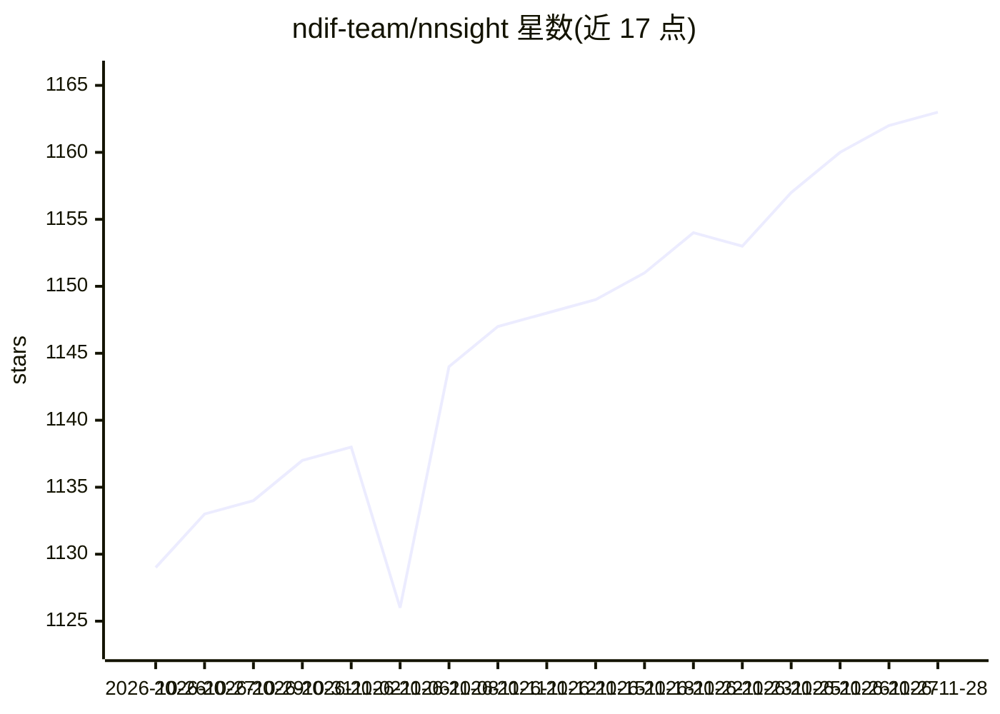

# ndif-team/nnsight

⭐ 1,163 · Python · MIT · 推送 2026-11-23 · [GitHub](https://github.com/ndif-team/nnsight) · [官网](https://nnsight.net/) · 组织维护

**为研究人员提供模型内部状态解释与干预的 Python 库**

nnsight 是一个 PyTorch 模型内部访问库：通过 `model.trace(...)` 上下文块以普通 Python 读写层输出、注意力模式与梯度，干预按前向传播顺序交织执行，无需注册 hook 或重构模型。支持任意 torch.nn.Module，内置 HuggingFace、diffusers、vLLM 封装，同一 trace 可本地运行或经 `remote=True` 通过 NDIF 远程执行超大模型。以 pip 安装，另提供面向 LLM agent 的技能与 MCP 文档接入。

## 筛选速览

| 维度 | 判定 | 备注 |
|---|---|---|
| AI 角色 | `ai-ecosystem` | LLM/agent 周边工具 |
| 许可风险 | `permissive` | MIT |
| 部署形态 | `library` | 以包/库形式分发 |
| 模型依赖 | local-ok | 支持本地模型 |
| 硬件要求 | — | 无带数字的原话,不猜 |
| 安装摩擦 | `low` | 无编译、无系统依赖或容器化 |
| 成熟度 | — | 结构信号不足 |

## 能力要点

- with model.trace(...) 块内直接读写/编辑任意内部张量，含梯度求取
- 支持任意 torch.nn.Module，附 HuggingFace/diffusers/vLLM 封装
- remote=True 通过 NDIF 远程运行本地无法承载的模型
- 多 prompt 批量 invoke、乱序模块调用（logit lens）、edit/skip/scan/cache/session

## 适用场景

- 研究 LLM 内部表征，做 logit lens 或梯度归因
- 在前向传播中编辑层输出，验证因果假设
- 通过 NDIF 远程访问无法本地部署的大模型内部

## 场景标签

`科研工具` · 领域:学习与行业

## 证据(README 行号)

> L3: Interpret and manipulate the internals of deep learning models
> L20: any PyTorch model and ships wrappers for HuggingFace, diffusers, and vLLM.

## 星数曲线

2026-10-26 1,129 → 2026-11-28 1,163（+34）

---
*卡片 v1 · prompt 1.4 · 生成 2026-11-25 · 置信度 high · 依据 README sha `ece0293979a4` · [字段定义](../../DATASET.md)*
