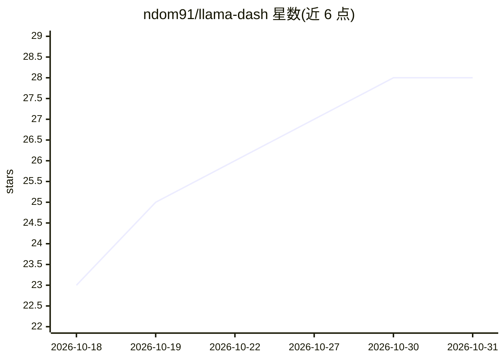

# ndom91/llama-dash

⭐ 28 · TypeScript · MIT · 推送 2026-10-29 · [GitHub](https://github.com/ndom91/llama-dash) · [官网](https://llama-dash.dev) · 个人维护

**本地 LLM 推理盒的运维网关：统一代理、观测与策略控制**

面向自托管本地推理机的运维层：以单一 UI 与公开入口代理 OpenAI/Anthropic 兼容客户端，承担认证、API key 管理、路由规则、请求历史与成本估算、Prometheus 指标导出等网关职能；推理后端当前实现为基于 llama.cpp 的 llama-swap，负责本地模型进程与推理。提供模型加载/卸载管理、聊天/图像/语音/转录 playground、按 key 的 RPM/TPM 限流。部署方式为 Docker Compose（AMD/ROCm 与 NVIDIA/CUDA 两套）或 Node 24+ 手动运行，MIT 许可。

## 筛选速览

| 维度 | 判定 | 备注 |
|---|---|---|
| AI 角色 | `ai-ecosystem` | LLM/agent 周边工具 |
| 许可风险 | `permissive` | MIT |
| 部署形态 | `self-host` | docker 或自建部署 |
| 模型依赖 | local-ok | 支持本地模型 |
| 硬件要求 | — | 无带数字的原话,不猜 |
| 安装摩擦 | `low` | 无编译、无系统依赖或容器化 |
| 成熟度 | — | 结构信号不足 |

## 能力要点

- OpenAI/Anthropic 兼容的单一代理入口，含 Claude Code 透传
- 请求历史、token 计数、成本估算与 Prometheus 指标导出
- 哈希 API key、按 key RPM/TPM 限流与模型访问控制
- 通过 llama-swap 管理 GGUF 模型加载/卸载与路由选择器

## 适用场景

- 给自建推理机加一层带认证和限流的统一 API 网关
- 观测本地模型流量、成本与 GPU/CPU 状态
- 把 Claude Code 等客户端路由到本地模型并留存请求审计

## 场景标签

`模型网关` `LLM 可观测性` · 领域:Agent 开发

## 证据(README 行号)

> L5: llama-dash turns a self-hosted local inference box into an observable, policy-controlled AI gateway: one UI for mode
> L7: It is the single public entrypoint for OpenAI-compatible and Anthropic-compatible clients. llama-dash owns proxy pol

## 星数曲线

2026-10-18 23 → 2026-10-31 28（+5）

---
*卡片 v1 · prompt 1.4 · 生成 2026-10-26 · 置信度 mid · 依据 README sha `677c9e6453f5` · [字段定义](../../DATASET.md)*
