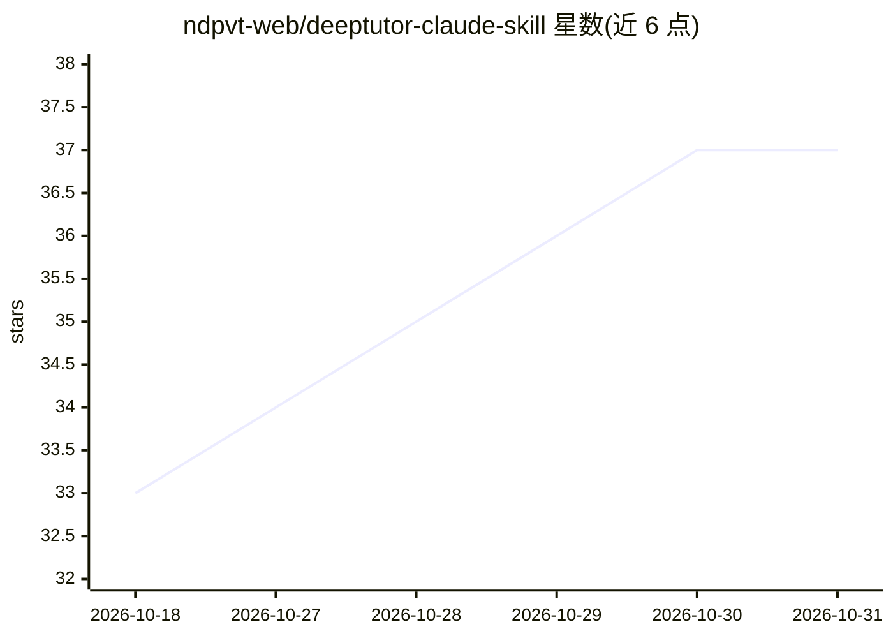

# ndpvt-web/deeptutor-claude-skill

⭐ 37 · Python · NOASSERTION · 推送 2026-03-12 · [GitHub](https://github.com/ndpvt-web/deeptutor-claude-skill) · 个人维护

**Claude Code 技能：把文档变成图增强 RAG 辅导教学会话**

将 HKUDS/DeepTutor 的图增强 RAG 教学方法论（而非其代码）适配为轻量 Claude Code skill。用户以对话触发，可把 PDF/教材/论文处理为分块+知识图谱的知识库，提供双循环解题（分析环+求解环）、难度校准的练习题生成、多节引用式深度研究报告与前置感知的引导式学习。Python 脚本负责 NetworkX 图存储、BM25 打分与图遍历，推理与文本理解由 Claude 原生完成。依赖仅 networkx，需 Claude Code 与 Python 3.9+。

## 筛选速览

| 维度 | 判定 | 备注 |
|---|---|---|
| AI 角色 | `ai-native` | 本体是模型或模型工具 |
| 许可风险 | `none` | NOASSERTION |
| 部署形态 | `library` | 以包/库形式分发 |
| 模型依赖 | — | README 未给出锁定关系 |
| 硬件要求 | — | 无带数字的原话,不猜 |
| 安装摩擦 | `low` | 无编译、无系统依赖或容器化 |
| 成熟度 | — | 结构信号不足 |

## 能力要点

- 文档→分块+实体关系知识图谱的知识库构建
- 双循环解题（Analysis Loop + Solve Loop）
- 难度校准练习题生成与引导式分步教学
- 多节带引用的深度研究报告，仅 1 个 pip 依赖

## 适用场景

- 让 Claude Code 帮我啃教材/论文并生成练习题
- 基于自己的笔记做带引用的深度研究报告
- 对教材问题做分步引导式解题学习

## 场景标签

`RAG` `知识图谱` `文档问答` · 领域:知识与检索

## 证据(README 行号)

> L3: A Claude Code skill that brings DeepTutor's graph-enhanced RAG tutoring methodology to your terminal. Transform docu
> L99: 1. **Claude handles**: PDF reading, text understanding, entity extraction, reasoning, tutoring, question generation

## 星数曲线

2026-10-18 33 → 2026-10-31 37（+4）

---
*卡片 v1 · prompt 1.4 · 生成 2026-10-26 · 置信度 mid · 依据 README sha `da220fc14423` · [字段定义](../../DATASET.md)*
