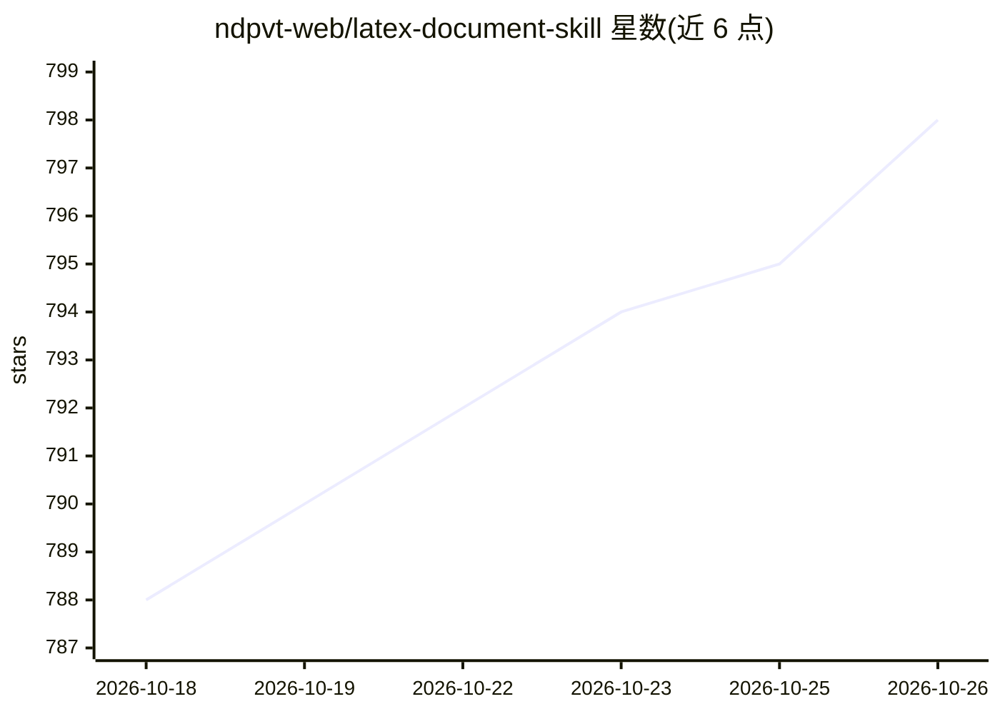

# ndpvt-web/latex-document-skill

⭐ 798 · TeX · 推送 2026-10-25 · [GitHub](https://github.com/ndpvt-web/latex-document-skill) · [官网](https://happycapy.ai/?via=gh) · 组织维护

**Claude Code 的 LaTeX 文档技能：自然语言生成排版 PDF**

面向 Claude Code 的 LaTeX 文档技能包，用户用自然语言描述文档即可产出编译好的 PDF：内置 27 个模板（简历、论文、学位论文、海报、试卷、速查表等）、27 个自动化脚本与 26 份参考指南。关键机制包括智能编译引擎（自动选择 pdflatex/xelatex/lualatex、多轮编译、自动修复与错误翻译）、基于视觉 OCR 的 PDF/手写笔记转 LaTeX 流水线、图表生成、邮件合并与 PDF 表单填写。声称无需掌握任何 LaTeX 命令。通过 npm 安装。

## 筛选速览

| 维度 | 判定 | 备注 |
|---|---|---|
| AI 角色 | `ai-ecosystem` | LLM/agent 周边工具 |
| 许可风险 | `none` | — |
| 部署形态 | `library` | 以包/库形式分发 |
| 模型依赖 | locked-api |  |
| 硬件要求 | — | 无带数字的原话,不猜 |
| 安装摩擦 | `low` | 无编译、无系统依赖或容器化 |
| 成熟度 | — | 结构信号不足 |

## 能力要点

- 27 个模板覆盖简历、学术论文、学位论文、海报、试卷、速查表等类型
- 智能编译引擎：自动检测引擎、多轮编译、自动修复常见错误并翻译报错信息
- 视觉 OCR 流水线将扫描件与手写笔记转为可编译 LaTeX（4 个 OCR 配置）
- 提供图表生成、BibTeX 抓取、PDF 加密、表单填写、版本 diff 等脚本

## 适用场景

- 把手写笔记或扫描教材转成排版好的 LaTeX 文档
- 用一句话生成简历、会议海报或试卷等成品 PDF
- 不熟悉 LaTeX 命令也能产出学术文档

## 场景标签

`OCR` `文档解析` · 领域:知识与检索

## 证据(README 行号)

> L3:  LaTeX Document Skill
> L17: You describe a document in plain English. This skill produces a compiled PDF.

## 星数曲线

2026-10-18 788 → 2026-10-26 798（+10）

---
*卡片 v1 · prompt 1.4 · 生成 2026-10-21 · 置信度 high · 依据 README sha `400fdbe3b816` · [字段定义](../../DATASET.md)*
