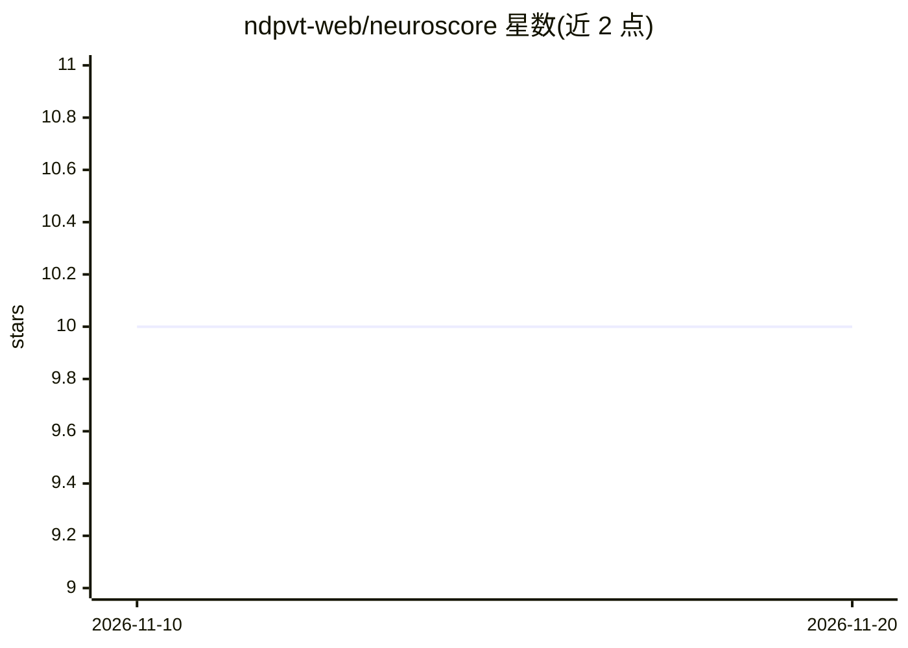

# ndpvt-web/neuroscore

⭐ 10 · Python · 推送 2026-04-04 · [GitHub](https://github.com/ndpvt-web/neuroscore) · 个人维护

**基于 TRIBE v2 预测内容对大脑激活影响的 CLI 与 Python 库**

封装 Meta FAIR 的 TRIBE v2 脑编码模型，对视频、音频或文本输出皮层激活张量，再转译为具名脑区时序、参与度分数、问题检测、A/B 对比与自然语言建议。提供 CLI 与 Python API，支持 GPU/CPU/云/演示四种后端自动检测与降级，无需 fMRI 扫描仪；演示模式使用包内预计算样例，输出合成数据。面向内容创作者、营销、教育与神经科学研究者。

## 筛选速览

| 维度 | 判定 | 备注 |
|---|---|---|
| AI 角色 | `ai-native` | 本体是模型或模型工具 |
| 许可风险 | `none` | — |
| 部署形态 | `library` | 以包/库形式分发 |
| 模型依赖 | — | README 未给出锁定关系 |
| 硬件要求 | — | 无带数字的原话,不猜 |
| 安装摩擦 | `low` | 无编译、无系统依赖或容器化 |
| 成熟度 | — | 结构信号不足 |

## 能力要点

- 提取 7 个脑区（杏仁核、ACC、dlPFC、vmPFC 等）的时序激活并检测激活顺序
- score/compare/youtube/demo 等 CLI 命令，输出 terminal/json/html
- 可插拔后端（GPU 16GB+/CPU/云/演示）与自定义分析模式扩展机制
- NeuroReport 结构化结果：overall_score、findings、region_map

## 适用场景

- 发布前为视频和文案评分，定位观众流失片段
- 对宣传材料做 A/B 神经激活对比
- 分析课程哪些段落导致注意力下降
- 检测神经强度高的内容并生成提示

## 场景标签

 · 领域:计算神经科学/内容分析

## 证据(README 行号)

> L14: Score any video, audio, or text for predicted neural engagement. Get back plain-English findings: where your conten
> L25: TRIBE v2 is Meta FAIR's brain encoding foundation model. It takes media and outputs a raw fMRI-like tensor of shape
> L103:   --> Backend (GPU / CPU / Cloud / Demo)      swappable, auto-detected

## 星数曲线

2026-11-10 10 → 2026-11-20 10（+0）

---
*卡片 v1 · prompt 1.4 · 生成 2026-11-19 · 置信度 high · 依据 README sha `fecfb13fa41b` · [字段定义](../../DATASET.md)*
