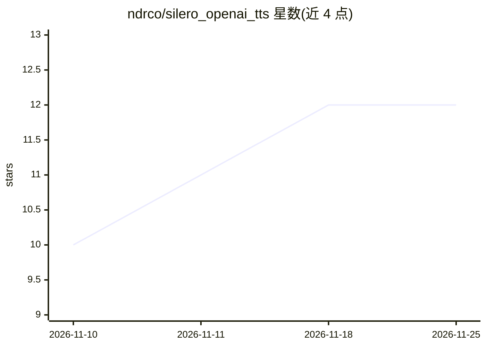

# ndrco/silero_openai_tts

⭐ 12 · Python · MIT · 推送 2026-02-25 · [GitHub](https://github.com/ndrco/silero_openai_tts) · 个人维护

**为 OpenClaw 提供本地自托管、兼容 OpenAI/ElevenLabs API 的 TTS 服务器**

基于 Silero TTS 模型（经 torch.hub 首次运行时下载）的本地自托管文本转语音服务器，实现 OpenAI TTS API 端点并可选启用 ElevenLabs 兼容 API。主要面向 OpenClaw 用户，使其在不依赖外部云服务的情况下进行语音输出；也兼容任何期望 OpenAI/ElevenLabs 端点的客户端。内置俄语和英语文本规范化（数字展开、俄语名词变格）、速度控制、磁盘缓存、可选 Bearer 认证与服务端自动播放。默认在 CPU 上运行，也可配置 CUDA。

## 筛选速览

| 维度 | 判定 | 备注 |
|---|---|---|
| AI 角色 | `ai-ecosystem` | LLM/agent 周边工具 |
| 许可风险 | `permissive` | MIT |
| 部署形态 | `desktop` | 安装包/桌面程序 |
| 模型依赖 | — | README 未给出锁定关系 |
| 硬件要求 | `cpu-ok` | |
| 安装摩擦 | `medium` | 含编译或系统依赖之一 |
| 成熟度 | — | 结构信号不足 |

## 能力要点

- 实现 OpenAI TTS API（POST /v1/audio/speech），可选启用 ElevenLabs 兼容端点
- 支持俄语与英语（自动识别）及数字展开文本规范化
- 提供 wav/mp3/opus/aac/flac 五种输出格式与 0.25–4.0 倍速控制
- 磁盘缓存避免重复合成，服务端自动播放支持跳过操作

## 适用场景

- 让 OpenClaw 通过本地服务器进行语音输出而不调用外部云服务
- 为任何 OpenAI 兼容客户端提供本地 TTS 后端
- 在 CPU 上运行 TTS，将 GPU 留给本地 LLM
- 使用 ElevenLabs 风格客户端接入本地语音合成

## 场景标签

`语音合成` · 领域:内容生成

## 证据(README 行号)

> L3: A **local**, self-hosted Text-to-Speech (TTS) server that implements both the **OpenAI TTS API** (`POST /v1/audio/sp
> L7: OpenClaw — so OpenClaw can speak without relying on external cloud services.
> L25: - **Designed for OpenClaw**, but works with any OpenAI-compatible client.

## 星数曲线

2026-11-10 10 → 2026-11-25 12（+2）

---
*卡片 v1 · prompt 1.4 · 生成 2026-11-18 · 置信度 high · 依据 README sha `429139bd7c53` · [字段定义](../../DATASET.md)*
