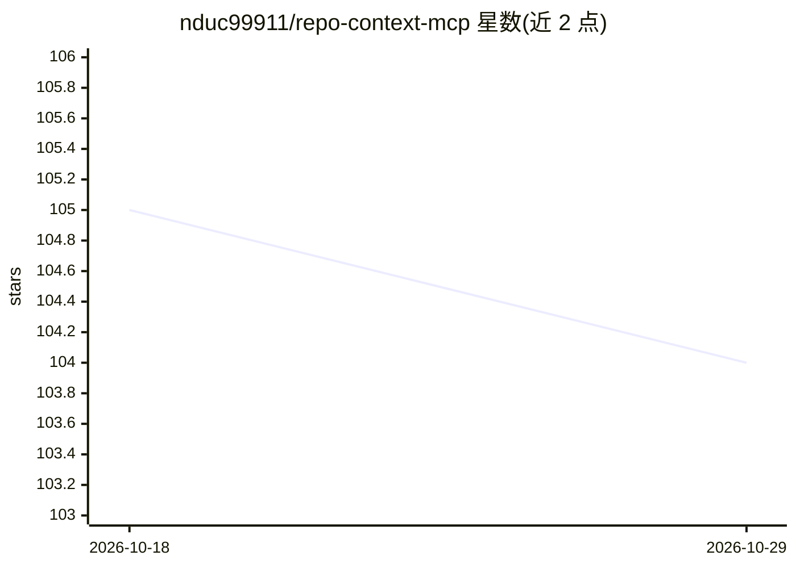

# nduc99911/repo-context-mcp

⭐ 104 · TypeScript · MIT · 推送 2026-08-12 · [GitHub](https://github.com/nduc99911/repo-context-mcp) · 个人维护

**帮 AI 编程 agent 理解仓库的 MCP 上下文服务器**

基于 Model Context Protocol 的 stdio 服务器，向 Codex、Claude Code、Cursor、Cline 等 AI 编程客户端暴露三个工具：repo_map 生成跳过 node_modules 等目录的轻量目录树与入口点识别，search_code 做子串搜索返回 path:line 命中，pack_context 按约 4 字符/token 的预算生成可粘贴到提示词的 markdown 文档。本地运行、无云端与遥测，另提供 CLI 与库 API，可不依赖 MCP 客户端使用。需 Node.js 18+，从源码构建或 npx 运行。

## 筛选速览

| 维度 | 判定 | 备注 |
|---|---|---|
| AI 角色 | `ai-ecosystem` | LLM/agent 周边工具 |
| 许可风险 | `permissive` | MIT |
| 部署形态 | `library` | 以包/库形式分发 |
| 模型依赖 | — | README 未给出锁定关系 |
| 硬件要求 | — | 无带数字的原话,不猜 |
| 安装摩擦 | `low` | 无编译、无系统依赖或容器化 |
| 成熟度 | — | 结构信号不足 |

## 能力要点

- repo_map / search_code / pack_context 三个 MCP 工具
- pack_context 按 token 预算（默认约 12000）对文件排序打包
- 本地运行、无遥测、stdio 传输，兼容任意 MCP 客户端
- 提供独立 CLI 与 TypeScript 库 API，可脱离 MCP 使用

## 适用场景

- 让 AI 编程 agent 在不倾倒整个 monorepo 的情况下获取仓库结构
- 为 PR 审查或 agent 提示词生成 token 预算内的代码上下文包
- 在代码库中快速定位包含关键子串的文件与行号

## 场景标签

 · 领域:开发者工具/AI 编程基础设施

## 证据(README 行号)

> L3: **MCP server that helps AI coding agents understand a repository** — without dumping the entire monorepo into the pr
> L14: AI agents waste tokens re-walking `node_modules`, missing entrypoints, or pasting random files. **repo-context-mcp*
> L20: |`pack_context`|Token-budgeted markdown pack for LLM prompts|

## 星数曲线

2026-10-18 105 → 2026-10-29 104（-1）

---
*卡片 v1 · prompt 1.4 · 生成 2026-10-23 · 置信度 high · 依据 README sha `cc9793efcd98` · [字段定义](../../DATASET.md)*
