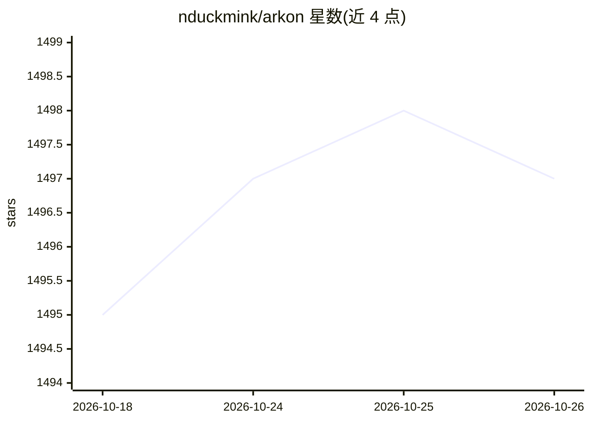

# nduckmink/arkon

⭐ 1,497 · Python · NOASSERTION · 推送 2026-06-03 · [GitHub](https://github.com/nduckmink/arkon) · 组织维护

**面向团队的自托管企业知识库与 MCP 服务器，向 LLM 供给受控上下文**

Arkon 是自托管的企业知识管理层：把 SOP、政策与内部文档经 MRP 管线（计划审查→LLM 合并→溯源→提交）编译为结构化 wiki，通过 MCP 服务器以 OAuth 2.1 + PKCE 向 Claude Desktop / Claude.ai 等 AI 客户端暴露搜索、阅读、草稿审批等工具。提供部门级隔离、细粒度 RBAC、审计日志与 AI 技能分发；LLM/嵌入/视觉模型可从 Anthropic、Google、OpenAI 目录中切换，全部推理走外部 API，无需 GPU。Docker Compose 部署 7 个容器，许可为 PolyForm Internal（内部使用免费，禁止对外提供服务）。

## 筛选速览

| 维度 | 判定 | 备注 |
|---|---|---|
| AI 角色 | `ai-ecosystem` | LLM/agent 周边工具 |
| 许可风险 | `none` | NOASSERTION |
| 部署形态 | `self-host` | docker 或自建部署 |
| 模型依赖 | locked-api |  |
| 硬件要求 | — | 无带数字的原话,不猜 |
| 安装摩擦 | `low` | 无编译、无系统依赖或容器化 |
| 成熟度 | — | 结构信号不足 |

## 能力要点

- MRP 管线将文档编译为可溯源 wiki，写入前需人工审查计划
- MCP 服务器向 Claude 等 AI 客户端暴露 wiki/来源/草稿工具，OAuth 2.1 登录
- 部门级隔离 + RBAC（Viewer/Contributor/Editor/Admin）+ 审计日志
- LLM/嵌入/视觉模型目录化选择，支持在线嵌入迁移

## 适用场景

- 把公司 SOP 与政策编成结构化 wiki 供员工通过 Claude 查询
- 按部门控制 AI 可访问的知识边界与权限
- 集中分发版本化的 agent 技能包到组织内部

## 场景标签

`知识库管理` · 领域:知识与检索

## 证据(README 行号)

> L9: **Arkon** is a self-hosted, enterprise-grade knowledge management layer that bridges organizational data and AI clie
> L51: ### 🔌 MCP Server for Claude & Other AI Clients
> L81: - **Backend:** FastAPI · PostgreSQL + pgvector · Redis (arq workers) · MinIO

## 星数曲线

2026-10-18 1,495 → 2026-10-26 1,497（+2）

---
*卡片 v1 · prompt 1.4 · 生成 2026-10-21 · 置信度 high · 依据 README sha `50e933900301` · [字段定义](../../DATASET.md)*
