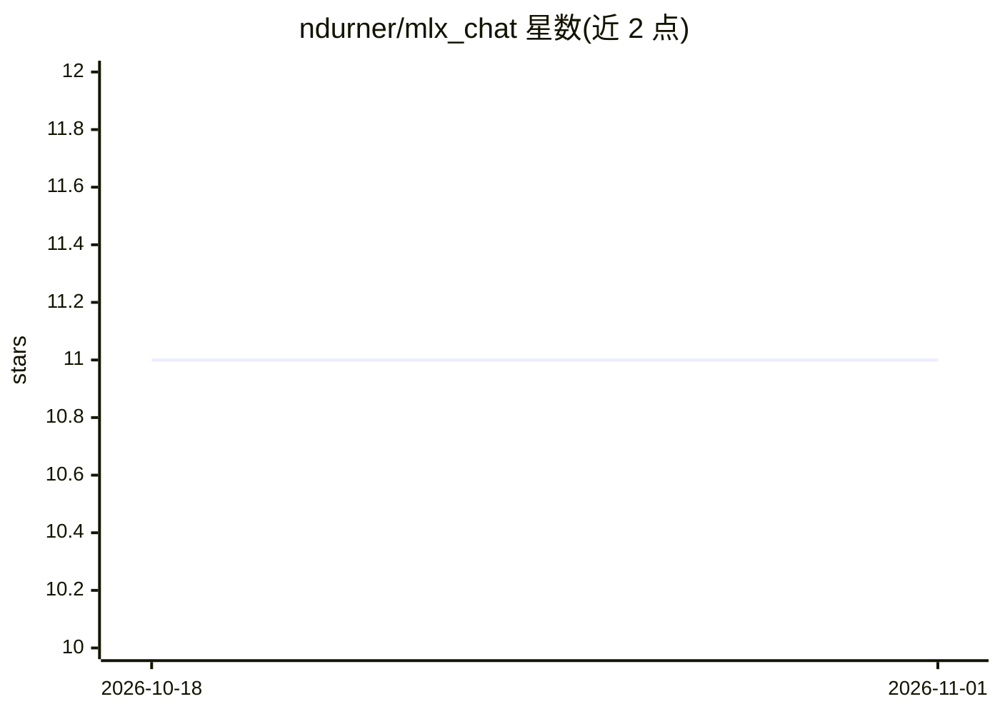

# ndurner/mlx_chat

⭐ 11 · Python · MIT · 推送 2026-09-21 · [GitHub](https://github.com/ndurner/mlx_chat) · 个人维护

**Apple Silicon 本地大模型对话界面（Gradio/FastMLX）**

基于 Gradio 与 FastMLX 的聊天界面，在 Apple Silicon 设备上本地运行语言模型进行对话。支持流式输出、纯文本文件上传、聊天历史下载与文件下载（如让模型生成 ICS 日历文件后下载）。安装流程：先安装 mlx-lm 与 fastmlx，通过 infra.py 查看与下载模型，再安装依赖并运行 app.py，在浏览器打开本地 URL 选择模型使用。

## 筛选速览

| 维度 | 判定 | 备注 |
|---|---|---|
| AI 角色 | `ai-native` | 本体是模型或模型工具 |
| 许可风险 | `permissive` | MIT |
| 部署形态 | `library` | 以包/库形式分发 |
| 模型依赖 | — | README 未给出锁定关系 |
| 硬件要求 | — | 无带数字的原话,不猜 |
| 安装摩擦 | `low` | 无编译、无系统依赖或容器化 |
| 成熟度 | — | 结构信号不足 |

## 能力要点

- Apple Silicon 设备上本地运行语言模型对话
- 流式输出与纯文本文件上传
- 聊天历史与生成文件（如 ICS 日历）下载
- 基于 Gradio 界面与 FastMLX 后端

## 适用场景

- 在 Mac 上本地与 Llama/Gemma 等模型对话
- 让模型生成文件（如日历文件）并下载使用
- 不上云、离线使用大模型

## 场景标签

`聊天机器人` · 领域:对话与助手

## 证据(README 行号)

> L3: Chat interface for MLX for on-device Language Model use on Apple Silicon.
> L4: Built on FastMLX.

## 星数曲线

2026-10-18 11 → 2026-11-01 11（+0）

---
*卡片 v1 · prompt 1.4 · 生成 2026-11-01 · 置信度 high · 依据 README sha `7a244c5b9db1` · [字段定义](../../DATASET.md)*
