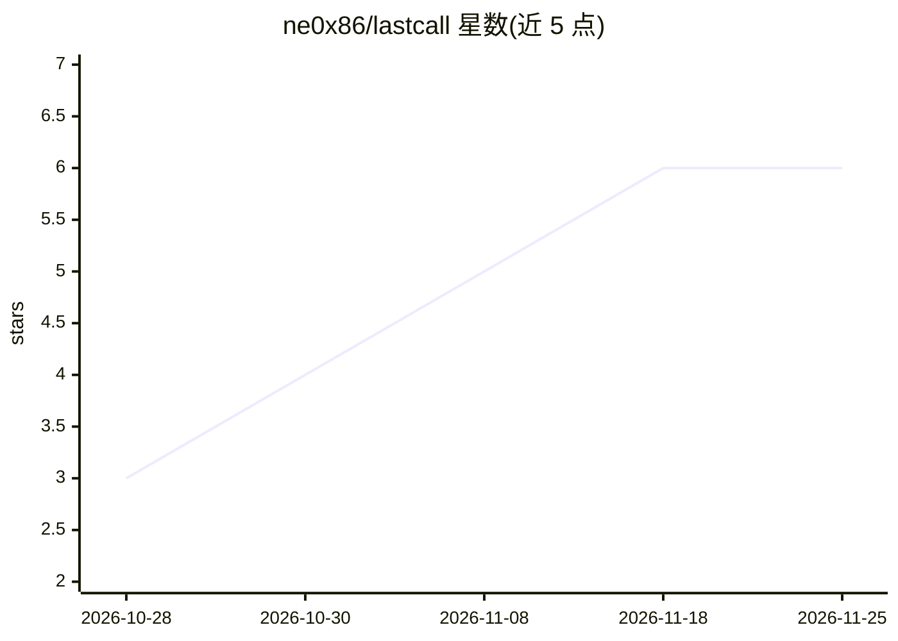

# ne0x86/lastcall

⭐ 6 · Python · Apache-2.0 · 推送 2026-11-01 · [GitHub](https://github.com/ne0x86/lastcall) · 个人维护

**自托管工具：把 AI 订阅重置前的剩余额度花在仓库审计与测试验证的 PR 上**

自托管的 GitHub App 服务，监控 Claude/ChatGPT 订阅的 5 小时与每周额度窗口，在重置临近且有余量时自动对用户仓库发起审计：四类审查者（bug、安全、卫生、性能）读代码，judge 过滤误报，每个 PR 由实现者写最小修复加回归测试，再由 lastcall 本身在干净容器中重跑测试并扫描密钥。所有变更经用户自己的 GitHub App 以 PR 形式交付，未经批准不合入；可拒绝项汇总到 issue。支持 API key 月度预算与本地模型（经 OpenCode），提供双语仪表盘与多渠道通知。

## 筛选速览

| 维度 | 判定 | 备注 |
|---|---|---|
| AI 角色 | `ai-ecosystem` | LLM/agent 周边工具 |
| 许可风险 | `permissive` | Apache-2.0 |
| 部署形态 | `self-host` | docker 或自建部署 |
| 模型依赖 | local-ok | 支持本地模型 |
| 硬件要求 | — | 无带数字的原话,不猜 |
| 安装摩擦 | `low` | 无编译、无系统依赖或容器化 |
| 成熟度 | — | 结构信号不足 |

## 能力要点

- 四类审查者加 judge 机制过滤审计噪音，多账号可联合审查
- agent 步骤在一次性非特权容器中运行，代码对审查者只读，出站走短白名单代理
- PR 由 lastcall 在干净容器中验证测试后才交付，未经批准不合入，支持自动提议 revert
- 仪表盘展示各账号剩余额度、下一次 burst 与待决事项，支持英语与西班牙语

## 适用场景

- 在 AI 订阅额度重置前把剩余容量花在仓库审计和补测试上
- 让 AI 修复已知漏洞或过时依赖并用我的测试验证
- 把 Sentry/Loki 中的高频错误交给它定位并提修复 PR
- 给 issue 打标签后由它在下次额度窗口自动处理

## 场景标签

`代码审查` `编码 Agent` `网络安全` · 领域:编码与开发

## 证据(README 行号)

> L15: It works through each vendor's official command-line tool, with your own login: today Claude Code and Codex. It can
> L95: lastcall drives each vendor's official command-line tool, with your own login, and OpenCode for API keys and local

## 星数曲线

2026-10-28 3 → 2026-11-25 6（+3）

---
*卡片 v1 · prompt 1.4 · 生成 2026-11-20 · 置信度 high · 依据 README sha `506bd228b775` · [字段定义](../../DATASET.md)*
