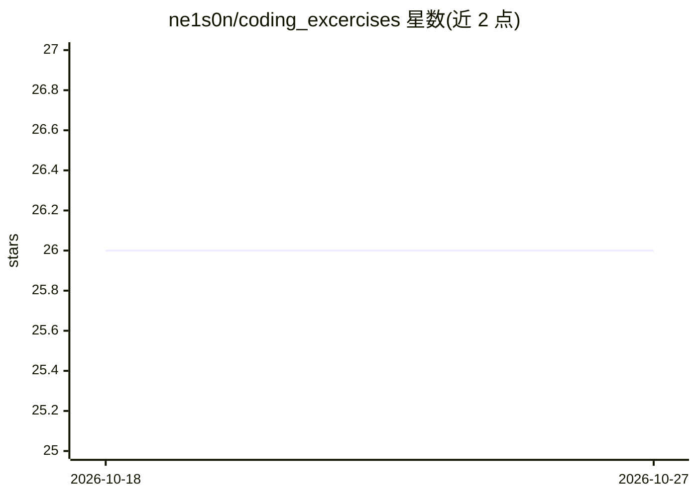

# ne1s0n/coding_excercises

⭐ 26 · Jupyter Notebook · MIT · 推送 2026-10-26 · [GitHub](https://github.com/ne1s0n/coding_excercises) · 组织维护

**生物学者深度学习入门课程的讲义与练习仓库**

Physalia 课程 'Introduction to deep learning for biologists'（2025）的配套材料仓库，由 Nelson Nazzicari 与 Filippo Biscarini 维护。内容按 5 天课程组织：讲义幻灯片、Jupyter Notebook 形式的练习与解答，主题涵盖 MNIST 图像识别、逻辑回归、交叉验证、卷积、数据增强、RNN 时间序列与文本、图像分割（U-Net），以及可选的 transformers 与 ProtBERT。练习可本地运行，也可通过 Binder、Google Colab 或 Kaggle Notebooks 在线探索。材料在课程周内发布，课程结束后在线保留数月。Python 基础部分已迁移至 bioinformateachers 仓库。

## 筛选速览

| 维度 | 判定 | 备注 |
|---|---|---|
| AI 角色 | `ai-knowledge` | 知识聚合/清单类 |
| 许可风险 | `permissive` | MIT |
| 部署形态 | `None` |  |
| 模型依赖 | — | README 未给出锁定关系 |
| 硬件要求 | — | 无带数字的原话,不猜 |
| 安装摩擦 | `low` | 无编译、无系统依赖或容器化 |
| 成熟度 | — | 结构信号不足 |

## 能力要点

- 5 天课程的幻灯片与 lab 文件夹组织
- 练习以 Jupyter Notebook 提供并附解答
- 覆盖图像识别、RNN、分割、迁移学习与 ProtBERT 等主题
- 支持 Binder/Colab/Kaggle 在线运行

## 适用场景

- 生物学背景学习者入门深度学习
- 按天跟随课程做练习并查看解答
- 在线平台免配置探索 notebook

## 场景标签

`教程课程` · 领域:学习与行业

## 证据(README 行号)

> L2: This repo contains slides and datasets used in the 2025 course Introduction to deep learning for biologists. Materia
> L4: Exercises are in the form of jupyter notebooks and can be either downloaded and run locally or explored online via p

## 星数曲线

2026-10-18 26 → 2026-10-27 26（+0）

---
*卡片 v1 · prompt 1.4 · 生成 2026-10-26 · 置信度 high · 依据 README sha `8fd00c3627d0` · [字段定义](../../DATASET.md)*
