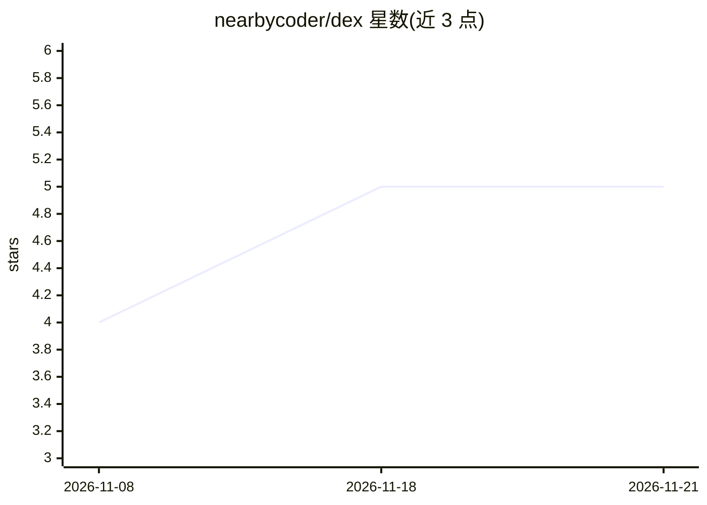

# nearbycoder/dex

⭐ 5 · Swift · MIT · 推送 2026-11-20 · [GitHub](https://github.com/nearbycoder/dex) · [官网](https://trydex.dev) · 个人维护

**部署在 Cloudflare 上的个人 AI agent：每聊天配云端 VM**

运行于 Cloudflare Durable Objects 的个人 agent harness：每个用户获得一个持久化 agent，通过 ClinePass、OpenCode Go 或 ChatGPT 订阅接入模型，以生成式 UI（卡片、表格、图表、表单）回答，并可在聊天专属的 Ubuntu 云 VM 上执行命令、操控桌面与浏览器。支持技能（skills.sh）、任意 MCP 服务器接入、文件附件处理与使用量查看；以 TanStack Start 构建，可部署为自己的实例，并提供 iPhone/iPad/Android 原生应用。

## 筛选速览

| 维度 | 判定 | 备注 |
|---|---|---|
| AI 角色 | `ai-native` | 本体是模型或模型工具 |
| 许可风险 | `permissive` | MIT |
| 部署形态 | `library` | 以包/库形式分发 |
| 模型依赖 | — | README 未给出锁定关系 |
| 硬件要求 | — | 无带数字的原话,不猜 |
| 安装摩擦 | `medium` | 含编译或系统依赖之一 |
| 成熟度 | — | 结构信号不足 |

## 能力要点

- 每聊天一个云 VM：可实时观看桌面与命令流，也可接管控制
- 生成式 UI 回答：卡片/表格/图表/表单随模型输出流式呈现
- 三种模型订阅任选组合，近 50 个模型单一菜单，列表每小时自动更新
- 技能系统与 MCP 服务器搜索、核验、一键接入

## 适用场景

- 部署一个属于自己的、可在手机上使用的个人 agent
- 让 agent 在云端 VM 上跑命令、操作浏览器完成实际任务
- 将自有 MCP 服务器接入聊天并查看其工具
- 用技能库扩展 agent 的任务指令

## 场景标签

`AI 助手` `浏览器自动化` `GUI 自动化` · 领域:效率与自动化

## 证据(README 行号)

> L1: Dex: your personal AI agent, running on Cloudflare
> L7: **Dex** is a personal agent harness. Each user gets an agent in a Cloudflare Durable Object running Pi Durable, thin
> L29: - **Three model subscriptions, connect any mix:** ClinePass and OpenCode Go (GLM, Kimi, DeepSeek, Qwen, MiniMax, Mi

## 星数曲线

2026-11-08 4 → 2026-11-21 5（+1）

---
*卡片 v1 · prompt 1.4 · 生成 2026-11-21 · 置信度 mid · 依据 README sha `549483c25651` · [字段定义](../../DATASET.md)*
