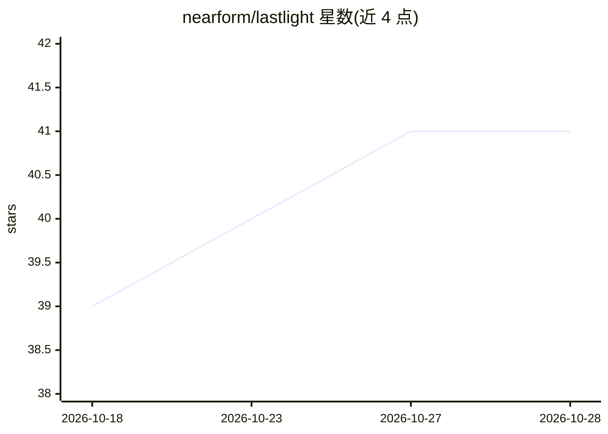

# nearform/lastlight

⭐ 41 · TypeScript · MIT · 推送 2026-10-26 · [GitHub](https://github.com/nearform/lastlight) · [官网](https://lastlight.dev) · 组织维护

**自托管的 AI 软件工厂：AI agent 维护 GitHub 仓库**

由 nearForm 维护、MIT 许可的自托管 agent 服务：通过 GitHub App 接入仓库，以 Architect → Executor → Reviewer 循环执行 issue 分诊、PR 审查、仓库健康监控与功能构建。技术栈为 TypeScript harness（webhook 摄取、cron 调度、进程管理）+ agentic-pi 工作流 + pi-ai 进程内聊天；模型 provider 无关，指向 pi-ai 支持的任意 provider/model（默认 anthropic/claude-sonnet-5-5）。沙箱可选 gondolin QEMU 微虚拟机或 Docker 容器；提供 npx 安装向导、Docker Compose 部署与原生 systemd 部署三种路径。

## 筛选速览

| 维度 | 判定 | 备注 |
|---|---|---|
| AI 角色 | `ai-native` | 本体是模型或模型工具 |
| 许可风险 | `permissive` | MIT |
| 部署形态 | `self-host` | docker 或自建部署 |
| 模型依赖 | locked-api |  |
| 硬件要求 | — | 无带数字的原话,不猜 |
| 安装摩擦 | `low` | 无编译、无系统依赖或容器化 |
| 成熟度 | — | 结构信号不足 |

## 能力要点

- Architect → Executor → Reviewer 多阶段 agent 开发循环
- provider 无关：接入 pi-ai 的 15+ 模型提供商，另支持 Codex/Claude Pro/Copilot 订阅 OAuth 登录
- gondolin 每阶段 QEMU 微虚拟机或 Docker 兄弟容器沙箱隔离
- npx lastlight setup 向导生成 instance/ 部署覆盖层并启动 Docker 栈

## 适用场景

- 自托管一个自动分诊 issue、审查 PR 的仓库维护机器人
- 让 AI agent 按多阶段流程在沙箱内构建功能
- 企业内私有化部署 AI 编码流水线并管理多仓库

## 场景标签

`编码 Agent` `代码审查` `多智能体` · 领域:Agent 开发

## 证据(README 行号)

> L8: An AI agent that maintains GitHub repositories: triaging issues, reviewing PRs, monitoring repo health, and building
> L10: Built on agentic-pi (workflow phases) and `@earendil-works/pi-ai` (in-process chat) with a lightweight TypeScript h

## 星数曲线

2026-10-18 39 → 2026-10-28 41（+2）

---
*卡片 v1 · prompt 1.4 · 生成 2026-10-25 · 置信度 high · 依据 README sha `acb15d1ddbeb` · [字段定义](../../DATASET.md)*
