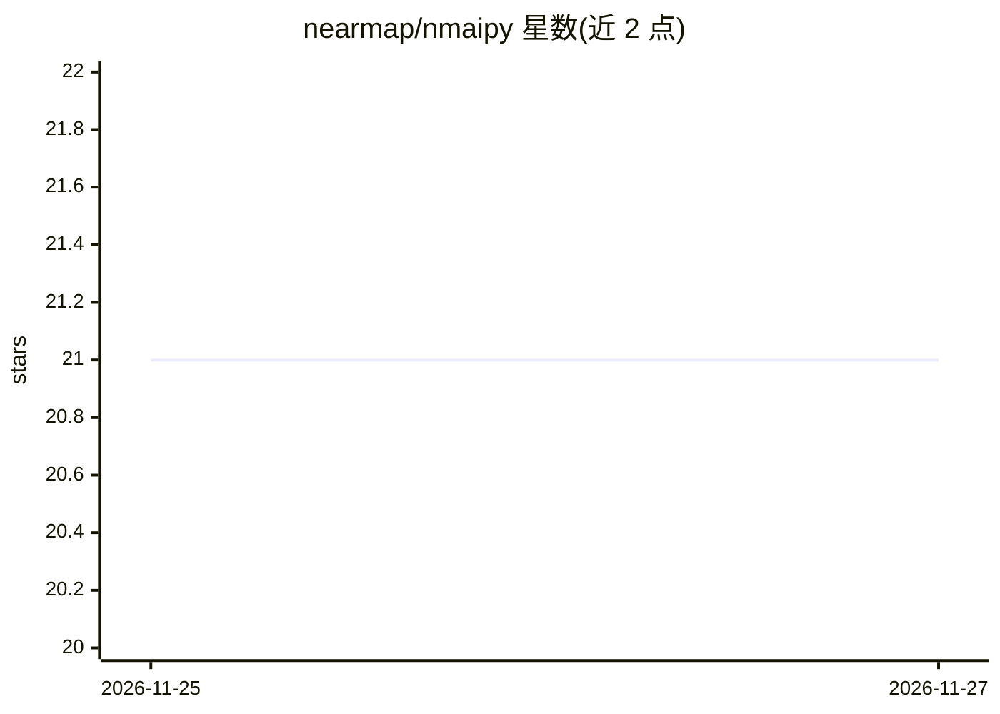

# nearmap/nmaipy

⭐ 21 · Python · Apache-2.0 · 推送 2026-11-26 · [GitHub](https://github.com/nearmap/nmaipy) · 组织维护

**从 Nearmap 航拍影像 API 提取建筑、屋顶、灾害等 AI 特征的 Python 库**

nmaipy 是 Nearmap AI 的 Python 工具库：通过 Feature API、RoofAgeApi、DamageConflationApi 等客户端，从 Nearmap 航拍影像中提取建筑轮廓、植被、屋况指数（RSI）、屋顶使用年限预测、野火防御空间分析及灾后损失分级，输出带数据字典的 CSV/rollup 结果。支持按 mesh block/census block 等任意多边形批量导出，可用 since/until 时间窗做变化检测；灾后流程要求小 AOI 并按 pack 类型区分标准与 post-cat 调查。需 API key 或短期 bearer token，Python 3.13+，通过 pip 安装。

## 筛选速览

| 维度 | 判定 | 备注 |
|---|---|---|
| AI 角色 | `ai-native` | 本体是模型或模型工具 |
| 许可风险 | `permissive` | Apache-2.0 |
| 部署形态 | `library` | 以包/库形式分发 |
| 模型依赖 | — | README 未给出锁定关系 |
| 硬件要求 | — | 无带数字的原话,不猜 |
| 安装摩擦 | `low` | 无编译、无系统依赖或容器化 |
| 成熟度 | — | 结构信号不足 |

## 能力要点

- Feature/RoofAge/DamageConflation 多个 API 客户端与批量导出器
- 支持 mesh block/census block 等任意多边形 AOI 的人口规模级分析
- 屋顶年限预测带置信度、证据类型与影像时间线
- 灾后损失分级：FEMA 5 级单调查评级与跨捕获 conflation 评级

## 适用场景

- 保险核保与房产估值中批量获取屋顶状况与房龄数据
- 飓风/野火等灾害后评估区域建筑损失等级
- 按人口普查区块做城市级 AI 特征覆盖分析并与人口数据合并
- 利用历史影像时间窗做屋顶变化检测

## 场景标签

`目标检测` `数据分析` · 领域:效率与自动化

## 证据(README 行号)

> L5: Extract building footprints, vegetation, damage assessments, roof condition, and other AI features from Nearmap's ae
> L31: The repository ships with a 10-property smoke-test script (`run_10_test.py`) that extracts building features and ro

## 星数曲线

2026-11-25 21 → 2026-11-27 21（+0）

---
*卡片 v1 · prompt 1.4 · 生成 2026-11-24 · 置信度 mid · 依据 README sha `167e37c0e95f` · [字段定义](../../DATASET.md)*
