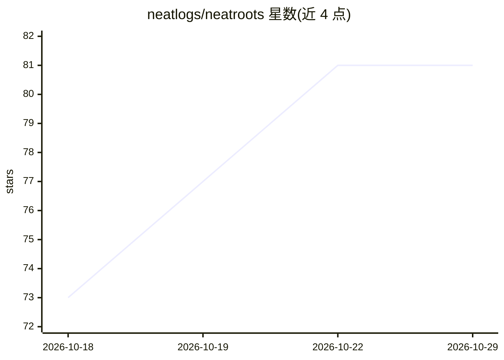

# neatlogs/neatroots

⭐ 81 · TypeScript · Apache-2.0 · 推送 2026-10-28 · [GitHub](https://github.com/neatlogs/neatroots) · 组织维护

**本地优先的 AI agent 运行观测工具：查看、检查并重放 agent 运行**

面向构建 AI agent 的开发者：在本机接收 agent 发送的 trace（Neatlogs SDK、OpenTelemetry OTLP、HTTP API 或导入文件），对每个 run 执行代码规则检查与决策模型的是/否问题，产出带原因、修复建议与对应 span 的问题清单。提供 Overview/Trace/TimeLine/Conversation 四种查看方式、搜索、单次 LLM 调用或整 agent 重放，并通过 23 个 MCP 工具接入 Claude Code、Codex、Cursor 等编码 agent。本地运行为主（本地 LLM 与 Laya 决策模型），托管模型为可选项；curl 脚本安装单文件 bundle（约 17 MB，macOS/Linux），Windows 需 WSL。

## 筛选速览

| 维度 | 判定 | 备注 |
|---|---|---|
| AI 角色 | `ai-ecosystem` | LLM/agent 周边工具 |
| 许可风险 | `permissive` | Apache-2.0 |
| 部署形态 | `library` | 以包/库形式分发 |
| 模型依赖 | local-ok | 支持本地模型 |
| 硬件要求 | — | 无带数字的原话,不猜 |
| 安装摩擦 | `low` | 无编译、无系统依赖或容器化 |
| 成熟度 | — | 结构信号不足 |

## 能力要点

- 接收 Neatlogs SDK / OpenTelemetry OTLP / HTTP API 的 trace 并支持文件导入
- 代码规则检查 + 决策模型回答是/否问题，产出原因与修复建议
- 重放单次 LLM 调用或整个 agent，编辑消息即可 fork 运行
- 23 个 MCP 工具接入 Claude Code、Codex、Cursor 等 9 种编码 agent

## 适用场景

- 调试自己的 AI agent：定位失败工具、循环调用与错误原因
- 在编码 agent 中用 MCP 工具读取和修复 neatroots 发现的问题
- 为 agent 编写 YAML 检查规则并在最近的 run 上预览

## 场景标签

`LLM 可观测性` · 领域:评测与运维

## 证据(README 行号)

> L6: **See, check and replay your AI agent's runs on your own machine while you build it.**
> L8: neatroots is where an agent starts out. It runs on your laptop, reads the traces your agent already
> L21: - **Checks every run.** Rules in code on every span (loops, repeated tool calls, error streaks,

## 星数曲线

2026-10-18 73 → 2026-10-29 81（+8）

---
*卡片 v1 · prompt 1.4 · 生成 2026-10-24 · 置信度 mid · 依据 README sha `0dfd728c312d` · [字段定义](../../DATASET.md)*
