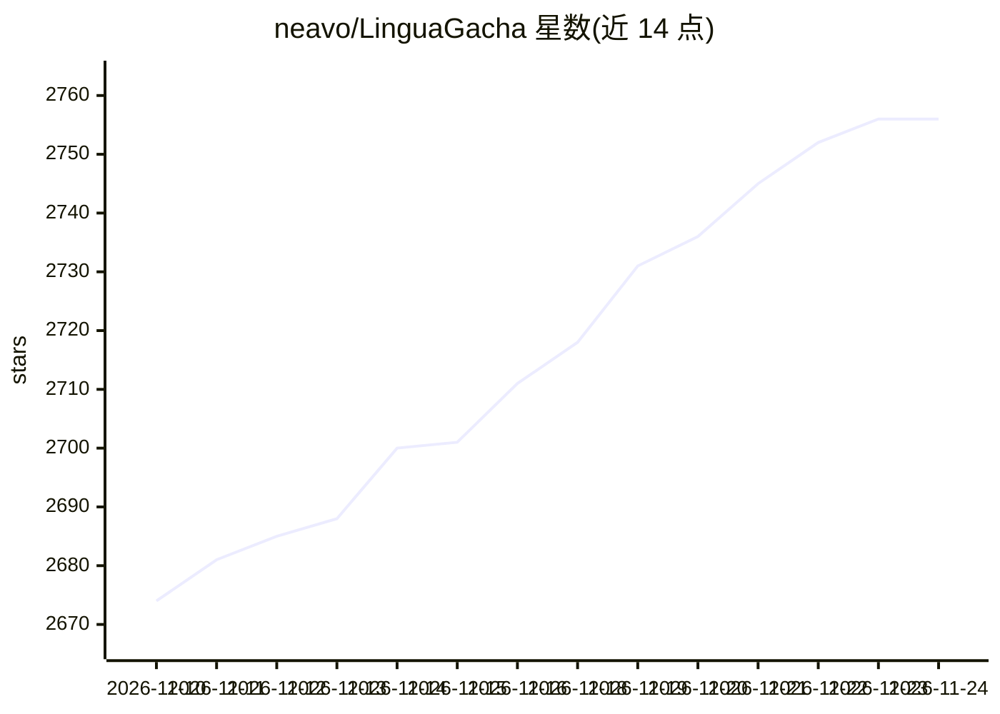

# neavo/LinguaGacha

⭐ 2,756 · TypeScript · 推送 2026-11-22 · [GitHub](https://github.com/neavo/LinguaGacha) · [官网](https://github.com/neavo/LinguaGacha/wiki) · 个人维护 · 中文 README

**面向无技术背景用户的 AI 多格式一键翻译工具**

桌面翻译应用，支持将图片/漫画、音视频与字幕、电子书（txt/md/epub/pdf/srt/ass 等）、游戏引擎文件（Godot/RenPy/RPGMAKER 等）拖入输入框后借助大模型接口自动互译。机制上提供自动术语表以保持专有名词一致、AGENT 语义校对与润色、样式效果保留。流程为：下载应用→配置大模型接口（如 DeepSeek）→拖入文件翻译。注意：源码仅作展示，禁止集成、修改、分发与二次开发。

## 筛选速览

| 维度 | 判定 | 备注 |
|---|---|---|
| AI 角色 | `ai-native` | 本体是模型或模型工具 |
| 许可风险 | `none` | — |
| 部署形态 | `desktop` | 安装包/桌面程序 |
| 模型依赖 | — | README 未给出锁定关系 |
| 硬件要求 | — | 无带数字的原话,不猜 |
| 安装摩擦 | `low` | 无编译、无系统依赖或容器化 |
| 成熟度 | — | 结构信号不足 |

## 能力要点

- 支持图片漫画、音视频、字幕、电子书、游戏引擎文件等多格式输入
- 自动生成术语表，保持专有名词跨作品统一
- AGENT 语义校对，指出问题后自动修正润色
- 提供 Windows/macOS/Linux 三平台安装包

## 适用场景

- 将日文漫画或图片批量翻译并保留排版
- 汉化 RenPy/RPGMAKER 等引擎的游戏文本
- 翻译字幕、电子书等长文本格式
- 无技术背景用户一键翻译音视频内容

## 场景标签

`AI 写作` · 领域:内容生成

## 证据(README 行号)

> L9: - LinguaGacha (/ˈlɪŋɡwə ˈɡɑːtʃə/)，翻译特化的次世代 `AGENT Harness`
> L17: - `全格式 - 万物皆可译，包括但不限于以下内容`
> L57: - 获取一个可靠的 AI 大模型接口，比如 [DeepSeek ]

## 星数曲线

2026-11-10 2,674 → 2026-11-24 2,756（+82）

---
*卡片 v1 · prompt 1.4 · 生成 2026-11-23 · 置信度 high · 依据 README sha `1c7ceb2b523e` · [字段定义](../../DATASET.md)*
