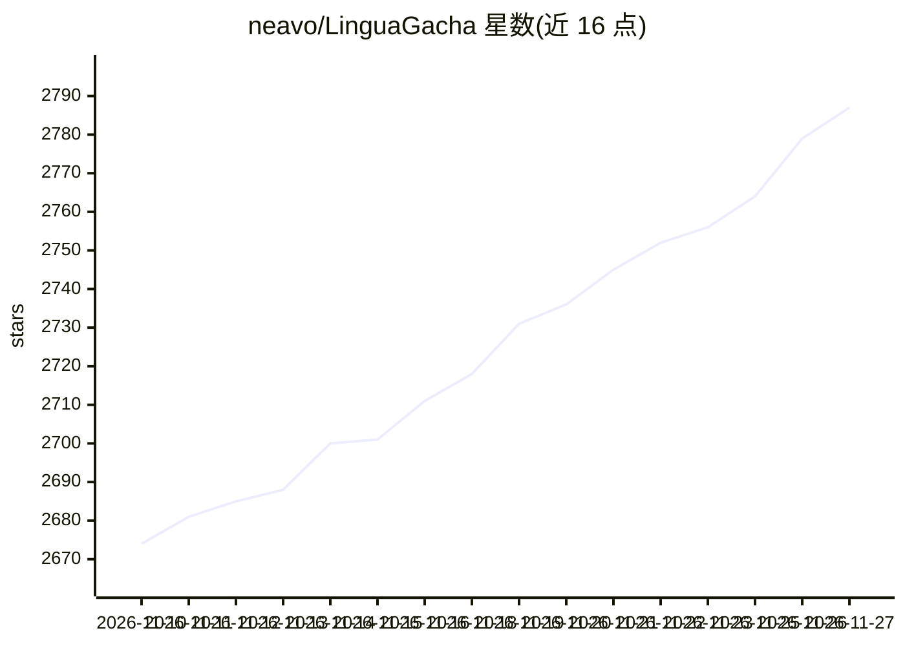

# neavo/LinguaGacha

⭐ 2,787 · TypeScript · 推送 2026-11-26 · [GitHub](https://github.com/neavo/LinguaGacha) · [官网](https://github.com/neavo/LinguaGacha/wiki) · 个人维护 · 中文 README

**面向漫画游戏音视频电子书的多格式 LLM 一键翻译应用**

以桌面应用形式提供的翻译工具，用户拖入待翻译文件后由内置 AGENT 流程调用大模型接口完成翻译。支持文本、字幕（srt/ass/vtt/lrc）、电子书（epub/pdf/txt/md）、图片漫画以及 Godot、RenPy、Tyrano、RPGMAKER 等游戏引擎数据文件的互译。提供术语表、文本保护、自定义提示词、校对等辅助功能，以及命令行模式与更新文件时保留已有译文的增量翻译。模型接口由用户自备，需配置 DeepSeek 等服务。注意：源码仅作展示，禁止集成、修改与分发。

## 筛选速览

| 维度 | 判定 | 备注 |
|---|---|---|
| AI 角色 | `ai-native` | 本体是模型或模型工具 |
| 许可风险 | `none` | — |
| 部署形态 | `desktop` | 安装包/桌面程序 |
| 模型依赖 | — | README 未给出锁定关系 |
| 硬件要求 | — | 无带数字的原话,不猜 |
| 安装摩擦 | `low` | 无编译、无系统依赖或容器化 |
| 成熟度 | — | 结构信号不足 |

## 能力要点

- 支持电子书、字幕、图片漫画与多种游戏引擎数据文件的全格式翻译
- 全自动一键互译流程，并提供术语表、文本保护与校对机制
- 更新文件时可在原工程保留已有译文，补译新增内容
- 提供 Windows/macOS/Linux 三平台安装包及命令行模式

## 适用场景

- 将 Galgame 或 RPGMaker 游戏文本批量翻译为其他语言
- 为动漫视频字幕和多语言电子书做翻译
- 翻译日漫美漫等图片漫画内容

## 场景标签

 · 领域:翻译/本地化工具

## 证据(README 行号)

> L10: - LinguaGacha (/ˈlɪŋɡwə ˈɡɑːtʃə/)，翻译特化的次世代 `AGENT Harness`
> L13:  - 全自动翻译，无需人工介入

## 星数曲线

2026-11-10 2,674 → 2026-11-27 2,787（+113）

---
*卡片 v1 · prompt 1.4 · 生成 2026-11-27 · 置信度 high · 依据 README sha `2576fc3610e1` · [字段定义](../../DATASET.md)*
