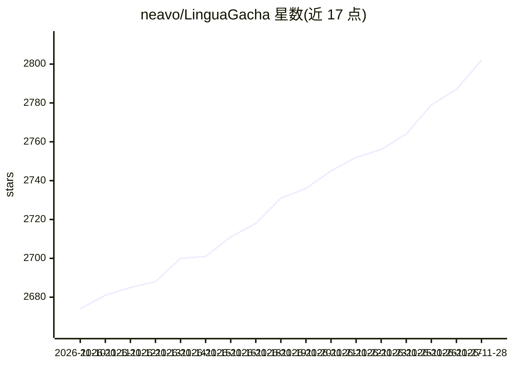

# neavo/LinguaGacha

⭐ 2,802 · TypeScript · 推送 2026-11-27 · [GitHub](https://github.com/neavo/LinguaGacha) · [官网](https://github.com/neavo/LinguaGacha/wiki) · 个人维护 · 中文 README

**面向游戏/漫画/音视频/电子书的 LLM 翻译桌面应用**

LinguaGacha 是一款以 LLM 为翻译引擎的桌面应用，自称翻译特化的 AGENT Harness。用户拖入待翻译文件后自动完成翻译与审校，支持音频视频、图片漫画、字幕、电子书（.txt/.md/.epub/.pdf/.srt 等）以及 MTool、Godot、RenPy、RPGMAKER 等游戏文本格式。通过发布页下载 Windows/macOS/Linux 安装包运行，需自行配置大模型接口（如 DeepSeek）。注意源码仅作展示，禁止集成、修改与分发。

## 筛选速览

| 维度 | 判定 | 备注 |
|---|---|---|
| AI 角色 | `ai-native` | 本体是模型或模型工具 |
| 许可风险 | `none` | — |
| 部署形态 | `desktop` | 安装包/桌面程序 |
| 模型依赖 | — | README 未给出锁定关系 |
| 硬件要求 | — | 无带数字的原话,不猜 |
| 安装摩擦 | `low` | 无编译、无系统依赖或容器化 |
| 成熟度 | — | 结构信号不足 |

## 能力要点

- 支持漫画、游戏、音视频、电子书等多类格式的一键翻译
- 覆盖 .epub/.pdf/.srt/.ass 等字幕电子书格式及 RenPy/RPGMAKER 等游戏引擎格式
- 内置术语表、文本保护、AGENT 校对与命令行模式
- Windows/macOS/Linux 三平台提供预编译安装包

## 适用场景

- 给 Galgame 或 RPG 游戏文本做外语本地化
- 批量翻译漫画图片和视频字幕
- 翻译 EPUB/PDF 电子书并保留已有译文增量更新

## 场景标签

`AI 写作` · 领域:内容生成

## 证据(README 行号)

> L10: - LinguaGacha (/ˈlɪŋɡwə ˈɡɑːtʃə/)，翻译特化的次世代 `AGENT Harness`
> L58: - 获取一个可靠的 AI 大模型接口，比如 [DeepSeek ]

## 星数曲线

2026-11-10 2,674 → 2026-11-28 2,802（+128）

---
*卡片 v1 · prompt 1.4 · 生成 2026-11-28 · 置信度 high · 依据 README sha `ab886b3a9c96` · [字段定义](../../DATASET.md)*
