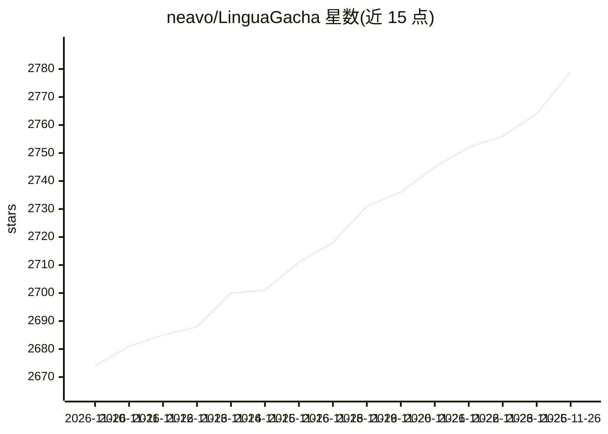

# neavo/LinguaGacha

⭐ 2,779 · TypeScript · 推送 2026-11-25 · [GitHub](https://github.com/neavo/LinguaGacha) · [官网](https://github.com/neavo/LinguaGacha/wiki) · 个人维护 · 中文 README

**调用大模型一键翻译漫画/游戏/音视频/电子书的全格式桌面工具**

以桌面应用形式发布的翻译工具，将待翻译文件拖入输入框后调用大模型接口自动完成翻译，覆盖音频视频、图片漫画、字幕电子书（txt/epub/pdf/srt/ass 等）及游戏引擎数据文件（Godot/RenPy/RPGMAKER 等）多类格式。提供术语表、文本保护、自定义提示词、AGENT 校对等功能，并附各内容类型的最佳实践教程。需自行获取大模型 API 接口。注意：作者声明源码仅作展示，禁止集成、修改与分发。

## 筛选速览

| 维度 | 判定 | 备注 |
|---|---|---|
| AI 角色 | `ai-native` | 本体是模型或模型工具 |
| 许可风险 | `none` | — |
| 部署形态 | `desktop` | 安装包/桌面程序 |
| 模型依赖 | — | README 未给出锁定关系 |
| 硬件要求 | — | 无带数字的原话,不猜 |
| 安装摩擦 | `low` | 无编译、无系统依赖或容器化 |
| 成熟度 | — | 结构信号不足 |

## 能力要点

- 支持音频、图片漫画、字幕电子书、游戏数据文件等多类格式输入
- 提供术语表、文本保护、文本替换与自定义提示词功能
- Windows/macOS/Linux 三平台提供安装包，含命令行模式
- 附 Godot/RenPy/Tyrano/RPGMAKER 等游戏引擎翻译的最佳实践教程

## 适用场景

- 把日文 Galgame 或 RPG 游戏文本翻译成中文
- 给漫画和动态漫画图片做翻译排版
- 翻译 srt/ass 字幕和 EPUB/PDF 电子书
- 为 ASMR 音频和视频内容生成译本

## 场景标签

 · 领域:翻译/本地化工具

## 证据(README 行号)

> L10: - LinguaGacha (/ˈlɪŋɡwə ˈɡɑːtʃə/)，翻译特化的次世代 `AGENT Harness`
> L12:  - 各语言全自动一键互译
> L41: - 从 发布页 下载应用

## 星数曲线

2026-11-10 2,674 → 2026-11-26 2,779（+105）

---
*卡片 v1 · prompt 1.4 · 生成 2026-11-24 · 置信度 high · 依据 README sha `86d82dd0830b` · [字段定义](../../DATASET.md)*
