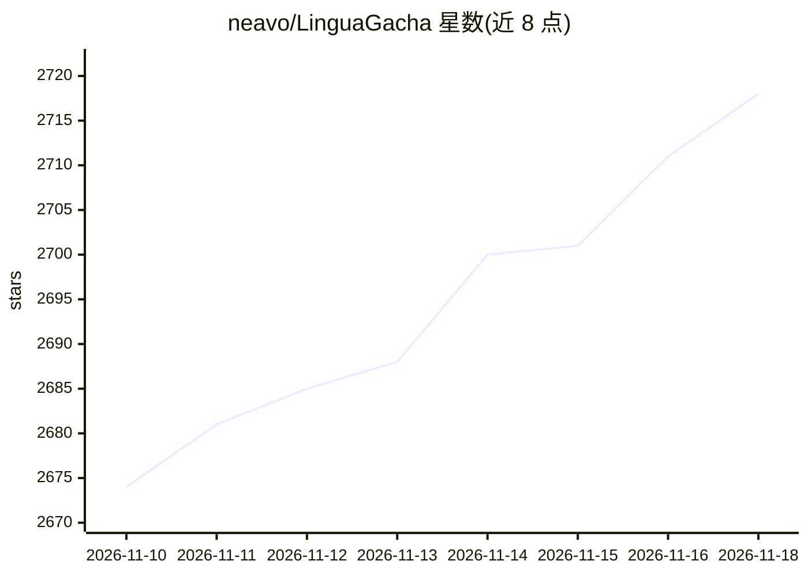

# neavo/LinguaGacha

⭐ 2,718 · TypeScript · 推送 2026-11-17 · [GitHub](https://github.com/neavo/LinguaGacha) · [官网](https://github.com/neavo/LinguaGacha/wiki) · 个人维护 · 中文 README

**面向普通用户的音视频/游戏/电子书一键 AI 翻译工具**

翻译特化的 AGENT Harness 桌面应用：将待翻译文件拖入输入框即可一键自动翻译，支持音频、视频、字幕、电子书（.txt/.md/.epub/.pdf/.srt/.ass 等）及 Godot、RenPy、Tyrano、WOLFRPG、RPGMAKER 等游戏引擎数据文件。机制上依赖外部 AI 大模型接口（如 DeepSeek），自动生成术语表保证专有名词统一，提供 AGENT 智能审校与命令行模式。面向无技术背景的普通用户，Windows/macOS/Linux 提供打包应用。限制：商用需作者授权，使用时需在作品信息中注明。

## 筛选速览

| 维度 | 判定 | 备注 |
|---|---|---|
| AI 角色 | `ai-native` | 本体是模型或模型工具 |
| 许可风险 | `none` | — |
| 部署形态 | `desktop` | 安装包/桌面程序 |
| 模型依赖 | — | README 未给出锁定关系 |
| 硬件要求 | — | 无带数字的原话,不猜 |
| 安装摩擦 | `low` | 无编译、无系统依赖或容器化 |
| 成熟度 | — | 结构信号不足 |

## 能力要点

- 支持音频/视频/字幕/电子书及多种游戏引擎数据文件翻译
- 自动生成术语表，保持整部作品专有名词统一
- 语义化智能审校，AGENT 自动修正与润色
- Windows/macOS/Linux 提供 x64 与 arm64 打包应用

## 适用场景

- 把生肉视频、ASMR 音频一键翻译成熟肉
- 无技术知识地为 Galgame/RPG 游戏打汉化补丁
- 翻译 EPUB/PDF 电子书并保留原有样式

## 场景标签

 · 领域:翻译/本地化

## 证据(README 行号)

> L9: - LinguaGacha (/ˈlɪŋɡwə ˈɡɑːtʃə/)，翻译特化的次世代 `AGENT Harness`
> L58: - 获取一个可靠的 AI 大模型接口，比如 [DeepSeek ]

## 星数曲线

2026-11-10 2,674 → 2026-11-18 2,718（+44）

---
*卡片 v1 · prompt 1.4 · 生成 2026-11-17 · 置信度 mid · 依据 README sha `acbcf476202a` · [字段定义](../../DATASET.md)*
