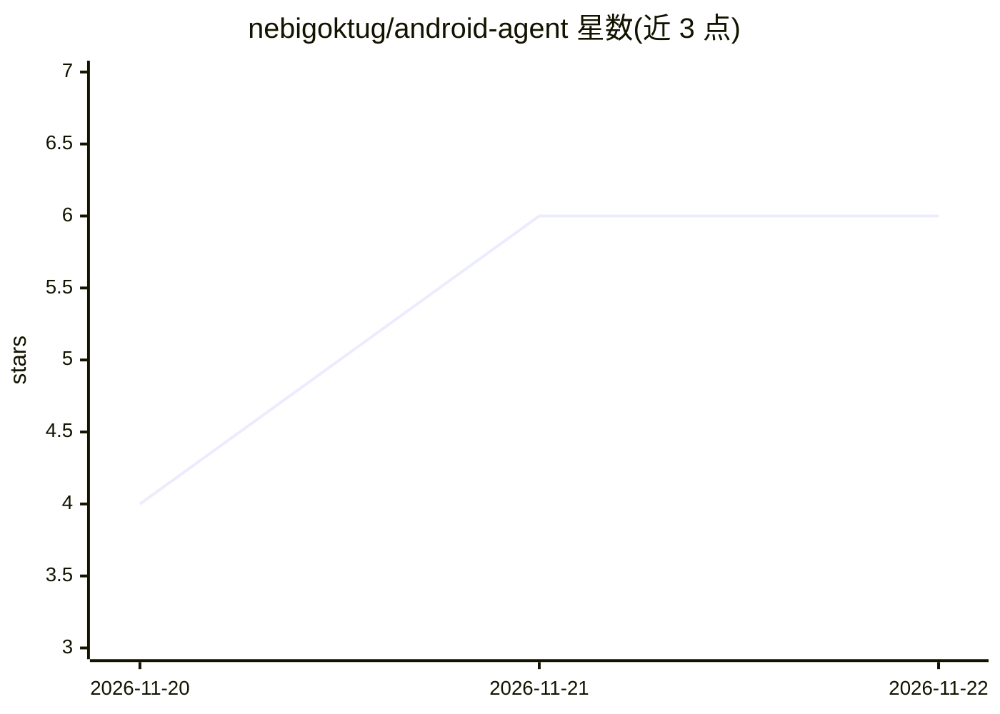

# nebigoktug/android-agent

⭐ 6 · Python · MIT · 推送 2026-11-19 · [GitHub](https://github.com/nebigoktug/android-agent) · 个人维护

**让 AI agent 通过文本方式操作安卓手机与应用的工具**

android-agent 通过 Android 无障碍树以文本形式读取屏幕，替代截图方式，将每次屏幕读取的 token 消耗从约 1500 降至约 150，并在首次读取后只发送变化内容。以 CLI 与 MCP server 形式提供，可从 PC（Windows/macOS/Linux）或手机端 Termux 运行，接入 Claude Code、Cursor 等 MCP 客户端。提供 screen/tap/type/swipe 等工具、可选 companion app 加速、盲点保护与敏感操作前确认机制。

## 筛选速览

| 维度 | 判定 | 备注 |
|---|---|---|
| AI 角色 | `ai-ecosystem` | LLM/agent 周边工具 |
| 许可风险 | `permissive` | MIT |
| 部署形态 | `library` | 以包/库形式分发 |
| 模型依赖 | — | README 未给出锁定关系 |
| 硬件要求 | — | 无带数字的原话,不猜 |
| 安装摩擦 | `low` | 无编译、无系统依赖或容器化 |
| 成熟度 | `idea` | |

## 能力要点

- 以无障碍树文本替代截图读取屏幕，token 消耗约降低 10 倍
- 以 CLI + MCP server 形式接入 Claude Code、Cursor 等 MCP 客户端
- 支持 PC（adb）与手机端 Termux（无线调试）两种运行方式
- 内置盲点保护、敏感操作前确认与紧急停止机制

## 适用场景

- 让 Claude Code 等 agent 代为操作手机应用完成任务
- 在无 PC 场景下用 Termux 让 agent 直接控制手机
- 以更低 token 成本自动化手机上的日常任务

## 场景标签

`GUI 自动化` · 领域:效率与自动化

## 证据(README 行号)

> L6: Plugs into Claude Code, Cursor, Claude Desktop and any other MCP client.
> L13: android-agent reads it as a short numbered list from Android's accessibility tree, and after the
> L78: claude mcp add phone -- python /path/to/android-agent/mcp_server.py

## 星数曲线

2026-11-20 4 → 2026-11-22 6（+2）

---
*卡片 v1 · prompt 1.4 · 生成 2026-11-21 · 置信度 mid · 依据 README sha `6c20606f253f` · [字段定义](../../DATASET.md)*
