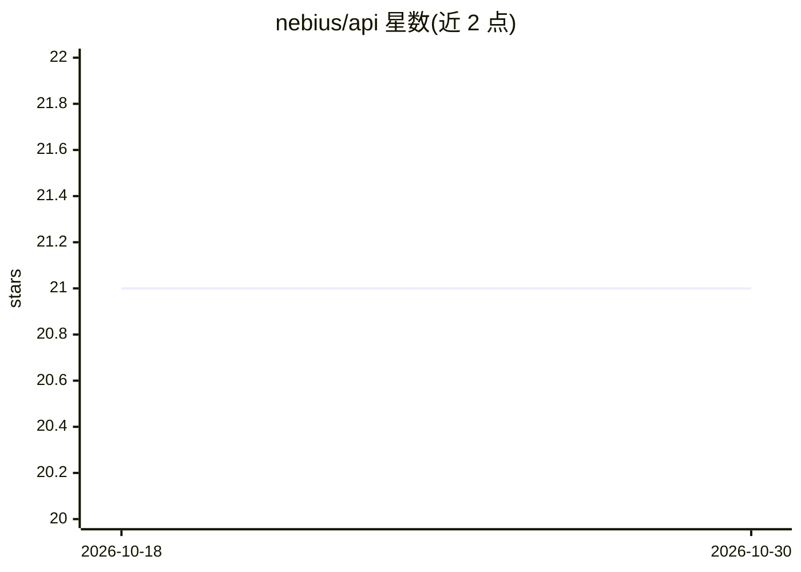

# nebius/api

⭐ 21 · MIT · 推送 2026-10-29 · [GitHub](https://github.com/nebius/api) · [官网](https://nebius.com) · 组织维护

**Nebius AI Cloud 的 gRPC API .proto 定义文件仓库**

由 Nebius 维护的 API 定义仓库：收录描述 Nebius AI Cloud 各服务（IAM、compute 等）请求/响应结构的 .proto 文件，客户端据此与 {service-name}.api.nebius.cloud:443 端点通信。README 说明配套工具（Nebius CLI、Terraform Provider、Go/Python SDK）、Bearer token 认证流程（含服务账号 JWT 换取 IAM token）、Update 方法的 X-ResetMask 语义、Operation 状态模型、错误详情与 X-Idempotency-Key 幂等机制。供需要直接对接该云 API 的开发者使用。MIT 许可。

## 筛选速览

| 维度 | 判定 | 备注 |
|---|---|---|
| AI 角色 | `ai-ecosystem` | LLM/agent 周边工具 |
| 许可风险 | `permissive` | MIT |
| 部署形态 | `None` |  |
| 模型依赖 | — | README 未给出锁定关系 |
| 硬件要求 | — | 无带数字的原话,不猜 |
| 安装摩擦 | `low` | 无编译、无系统依赖或容器化 |
| 成熟度 | — | 结构信号不足 |

## 能力要点

- 以 Protocol Buffers 定义各 gRPC 服务的请求/响应结构
- 覆盖用户/服务账号两种 Bearer token 认证流程
- 文档化 X-ResetMask 字段更新语义与操作状态模型
- 支持 X-Idempotency-Key 请求幂等机制

## 适用场景

- 基于 .proto 生成客户端代码对接 Nebius AI Cloud 服务
- 用 grpcurl 直接调用 gRPC 接口调试资源管理
- 了解该云平台认证、错误处理与幂等约定

## 场景标签

 · 领域:云计算/AI 基础设施 API

## 证据(README 行号)

> L3: This repository contains the `.proto` files defining the gRPC API for Nebius AI Cloud services.
> L19: Nebius AI Cloud gRPC services are available at endpoints formatted as `{service-name}.api.nebius.cloud:443`.

## 星数曲线

2026-10-18 21 → 2026-10-30 21（+0）

---
*卡片 v1 · prompt 1.4 · 生成 2026-10-28 · 置信度 high · 依据 README sha `78a97e4ca5e1` · [字段定义](../../DATASET.md)*
