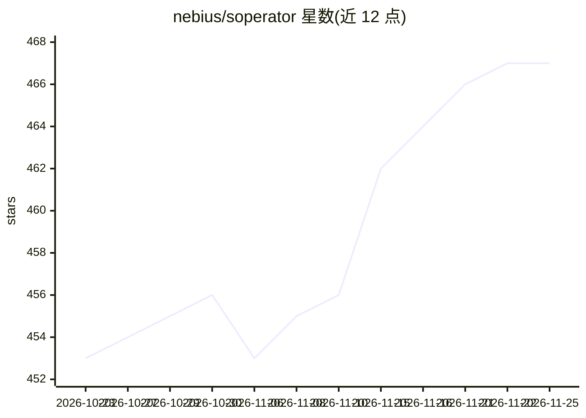

# nebius/soperator

⭐ 467 · Go · Apache-2.0 · 推送 2026-11-23 · [GitHub](https://github.com/nebius/soperator) · 组织维护

**面向平台团队的 Kubernetes 上运行 Slurm 集群 operator**

Soperator 是一个 Kubernetes operator，将 `SlurmCluster` 自定义资源转换为可用的 Slurm 集群，包含控制器、登录节点、worker、共享存储（jail 根文件系统）、CUDA/NCCL 栈、健康检查与计账组件。面向需要以声明式方式提供 Slurm 的平台团队，以及从裸金属迁移到 Kubernetes 的团队。通过被动/主动健康检查自动排空和替换故障节点，支持临时 worker 与 InfiniBand 感知调度。要求 Kubernetes ≥1.35、Helm ≥3.14、CUDA >13.0，提供 Self-deploy、Nebius 托管服务与 Soperator Pro 等部署路径，存在单分区及 GPU-only/CPU-only 集群约束。

## 筛选速览

| 维度 | 判定 | 备注 |
|---|---|---|
| AI 角色 | `ai-enhanced` | 去掉 AI 部分产品仍成立 |
| 许可风险 | `permissive` | Apache-2.0 |
| 部署形态 | `None` |  |
| 模型依赖 | — | README 未给出锁定关系 |
| 硬件要求 | — | 无带数字的原话,不猜 |
| 安装摩擦 | `medium` | 含编译或系统依赖之一 |
| 成熟度 | — | 结构信号不足 |

## 能力要点

- 单个 `SlurmCluster` 资源声明式管理控制器、登录、worker、存储与计账
- 被动/主动健康检查检测 GPU、网络、存储问题并自动排空替换故障节点
- jail 共享根文件系统使集群节点软件与配置保持一致
- 支持 AWS/GCP/Azure/Nebius/OCI、裸金属与气隙环境部署

## 适用场景

- 在自有 Kubernetes 上为 AI 训练提供 Slurm 集群
- 从裸金属 Slurm 迁移到 Kubernetes 管理
- 通过健康检查减少长任务因 GPU 故障中断
- 用临时 worker 按需伸缩 GPU 容量

## 场景标签

`模型训练` · 领域:训练与推理

## 证据(README 行号)

> L5: Soperator is an open-source Kubernetes operator for running Slurm clusters for AI training and high-performance comp
> L24: Slurm is a common scheduler for AI training and HPC workloads. Soperator is a Kubernetes operator that turns a `Slu
> L26: It is intended for platform teams and engineers who need to provide Slurm without managing each part of the cluster

## 星数曲线

2026-10-23 453 → 2026-11-25 467（+14）

---
*卡片 v1 · prompt 1.4 · 生成 2026-11-25 · 置信度 high · 依据 README sha `83c3c9a37fa6` · [字段定义](../../DATASET.md)*
