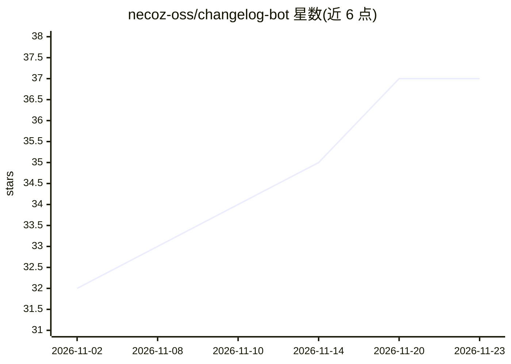

# necoz-oss/changelog-bot

⭐ 37 · TypeScript · MIT · 推送 2026-11-22 · [GitHub](https://github.com/necoz-oss/changelog-bot) · 个人维护

**AI 生成变更日志的 CLI 与 GitHub Action**

从 Git 历史、PR 标题与 release notes 生成 changelog 条目，可选择开启 PR；以 CLI 与 GitHub Action 两种形式提供，面向希望在 CI 或本地自动产出变更日志的开发者。可选接入 OpenAI/Anthropic/Gemini/xAI 做摘要，无 API key 时回退到基于 git log 的启发式确定性输出；支持 --no-ai 跳过模型调用、从 PR 描述提取 WHY 原因、指令文件自定义风格与 JSON 配置文件。自述处于 v0.0.x 早期阶段，接口可能在 v1.0.0 前变动。

## 筛选速览

| 维度 | 判定 | 备注 |
|---|---|---|
| AI 角色 | `ai-native` | 本体是模型或模型工具 |
| 许可风险 | `permissive` | MIT |
| 部署形态 | `library` | 以包/库形式分发 |
| 模型依赖 | locked-api |  |
| 硬件要求 | — | 无带数字的原话,不猜 |
| 安装摩擦 | `low` | 无编译、无系统依赖或容器化 |
| 成熟度 | `idea` | |

## 能力要点

- 合并 commit 历史、PR 标题与 release notes 生成 changelog 并可开 PR
- 支持 openai/anthropic/gemini/xai 提供方，缺 key 时启发式回退或 --no-ai 确定性输出
- 从 PR 描述提取 WHY 说明（LLM 或实验性 Jev 引擎）
- 以 CLI（pnpm dlx）与 GitHub Action 两种方式运行

## 适用场景

- 发版时自动生成变更日志并开 PR
- 在 CI 流水线中维护 CHANGELOG.md 与 compare 链接
- 不想配 AI key 时用确定性回退生成本次变更说明

## 场景标签

`AI 写作` · 领域:内容生成

## 证据(README 行号)

> L7: `@nyaomaru/changelog-bot` 🤖 turns your Git history and release notes into a polished changelog entry (and optional P
> L14: - **LLM superpowers (optional):** Connect OpenAI or Anthropic for tone-aware summaries or skip API keys entirely an
> L17: - **CI-native:** Works as a GitHub Action, reusable workflow, or plain CLI—no fragile scripting required.

## 星数曲线

2026-11-02 32 → 2026-11-23 37（+5）

---
*卡片 v1 · prompt 1.4 · 生成 2026-11-18 · 置信度 high · 依据 README sha `95b77312606f` · [字段定义](../../DATASET.md)*
