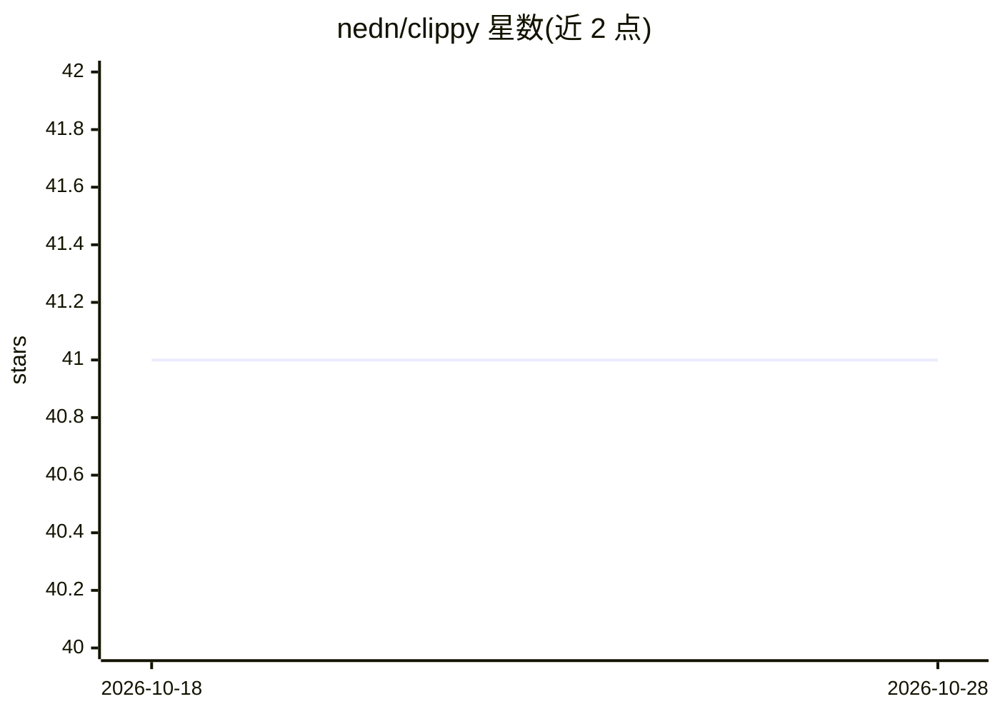

# nedn/clippy

⭐ 41 · Python · MIT · 推送 2025-11-03 · [GitHub](https://github.com/nedn/clippy) · 个人维护

**终端里直接调用多模型 AI 的 CLI 工具，附代码打包脚本**

Python 编写的命令行工具 clippy 及配套 pack 脚本：在终端向 OpenAI、Google Gemini、Anthropic Claude 及兼容 OpenAI API 端点的模型提问、总结文本、生成命令；通过管道接收输入（如 man 手册、git diff、文件内容）。pack 脚本递归扫描目录、并行读取文本文件、跳过二进制与隐藏文件，支持 include/exclude 过滤与按 tiktoken 统计 token 数，用于把代码库打包进模型上下文。安装方式为 git clone 后加入 PATH，依赖由 run_script.sh 自动装入虚拟环境；模型与 API key 存于 ~/.clippy/config.json。

## 筛选速览

| 维度 | 判定 | 备注 |
|---|---|---|
| AI 角色 | `ai-native` | 本体是模型或模型工具 |
| 许可风险 | `permissive` | MIT |
| 部署形态 | `library` | 以包/库形式分发 |
| 模型依赖 | locked-api |  |
| 硬件要求 | — | 无带数字的原话,不猜 |
| 安装摩擦 | `medium` | 含编译或系统依赖之一 |
| 成熟度 | — | 结构信号不足 |

## 能力要点

- 支持 OpenAI / Gemini / Claude 及 OpenAI 兼容端点的多模型调用
- 管道输入：man 手册、git diff、文件内容直接喂给模型
- pack 脚本递归打包代码库，支持 glob 过滤与 token 数统计（tiktoken）
- run_script.sh 自动创建虚拟环境并安装依赖

## 适用场景

- 在终端里快速向 AI 提问、总结文本、生成 shell/git 命令
- 把整个代码库打包后让 AI 分析或回答关于项目的问题
- 估算并裁剪文件集以适配模型上下文窗口

## 场景标签

`AI 助手` · 领域:对话与助手

## 证据(README 行号)

> L3: **Clippy** is a simple yet powerful command-line interface (CLI) tool that lets you interact with various AI models 
> L7: * **Multi-Model Support:** Works with OpenAI (gpt-4o, gpt-3.5-turbo, etc.), Google Gemini (gemini-pro), and Anthropi

## 星数曲线

2026-10-18 41 → 2026-10-28 41（+0）

---
*卡片 v1 · prompt 1.4 · 生成 2026-10-25 · 置信度 mid · 依据 README sha `b39ca2beefc7` · [字段定义](../../DATASET.md)*
