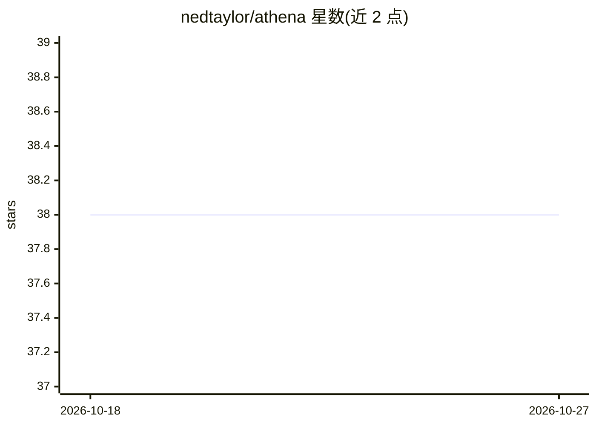

# nedtaylor/athena

⭐ 38 · Fortran · MIT · 推送 2026-09-07 · [GitHub](https://github.com/nedtaylor/athena) · 个人维护

**面向物理应用的 Fortran 神经网络库：CNN、图网络与 PINN**

ATHENA 是以 Fortran 编写的神经网络开发库，侧重卷积神经网络，支持 1/2/3 维卷积、批归一化、dropout/dropblock 正则化层与平均池化等层类型；通过消息传递层支持图神经网络，并借助自动微分支持物理信息神经网络（PINN）。主要面向材料科学等物理领域研究场景，利用 Fortran 的数组运算与高性能计算生态。提供 fpm、CMake、Spack 三种构建途径，含 MNIST 示例与可选 Weights & Biases 集成；需要 Fortran 2018 及以上编译器与 graphstruc 库。

## 筛选速览

| 维度 | 判定 | 备注 |
|---|---|---|
| AI 角色 | `ai-native` | 本体是模型或模型工具 |
| 许可风险 | `permissive` | MIT |
| 部署形态 | `None` |  |
| 模型依赖 | — | README 未给出锁定关系 |
| 硬件要求 | — | 无带数字的原话,不猜 |
| 安装摩擦 | `medium` | 含编译或系统依赖之一 |
| 成熟度 | — | 结构信号不足 |

## 能力要点

- 支持 1/2/3 维卷积、批归一化、dropout/dropblock 与平均池化层
- 消息传递层实现图神经网络，自动微分支持物理信息神经网络（PINN）
- 提供 fpm/CMake/Spack 构建与 MNIST 示例程序
- 可选 wandb-fortran 集成，支持训练日志与超参扫描

## 适用场景

- 在 Fortran/HPC 项目中构建卷积或图神经网络
- 材料科学中基于电荷密度与原子结构的学习任务
- 以 PINN 求解物理问题（如 Burgers 方程示例）

## 场景标签

`模型训练` · 领域:训练与推理

## 证据(README 行号)

> L14: ATHENA (Adaptive Training for High Efficiency Neural network Applications) is a Fortran library for developing and 
> L30: Building on this, the library also supports strongly physics-focused architectures through providing capabilties of
> L32: One of the primary intended applications of athena is in materials science, which heavily utilises convolutional an

## 星数曲线

2026-10-18 38 → 2026-10-27 38（+0）

---
*卡片 v1 · prompt 1.4 · 生成 2026-10-25 · 置信度 high · 依据 README sha `ccfce2f7c8ec` · [字段定义](../../DATASET.md)*
