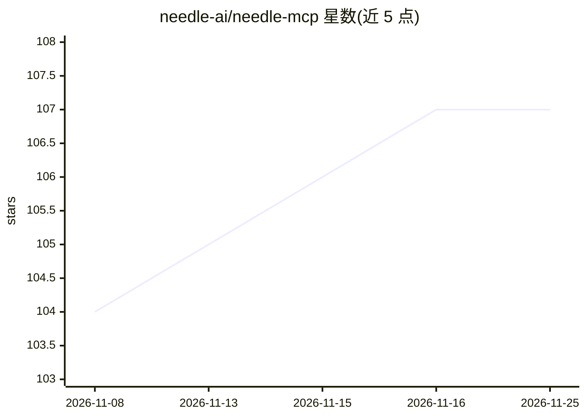

# needle-ai/needle-mcp

⭐ 107 · 推送 2026-11-04 · [GitHub](https://github.com/needle-ai/needle-mcp) · [官网](https://needle.app) · 组织维护

**面向外呼销售的 MCP 服务器：让 AI 客户端执行找线索与触达**

Needle 的外呼引擎以 MCP 工具形式提供的托管服务，服务器地址为 https://needle.app/mcp/v1。Agent 可通过工具构建来自 LinkedIn 和 Places 的线索列表、在 LinkedIn/Instagram/邮件上运行多渠道多账号外呼活动、起草待人工审核的消息、管理抑制名单并通过 Webhook 接收外呼事件。本仓库为设置指南，覆盖 Claude、ChatGPT、Codex、Cursor、Grok、OpenCode 等 MCP 客户端的接入步骤，认证支持浏览器 OAuth 与 API key（令牌一小时过期自动刷新）。

## 筛选速览

| 维度 | 判定 | 备注 |
|---|---|---|
| AI 角色 | `ai-ecosystem` | LLM/agent 周边工具 |
| 许可风险 | `none` | — |
| 部署形态 | `library` | 以包/库形式分发 |
| 模型依赖 | locked-api |  |
| 硬件要求 | — | 无带数字的原话,不猜 |
| 安装摩擦 | `low` | 无编译、无系统依赖或容器化 |
| 成熟度 | — | 结构信号不足 |

## 能力要点

- 从 LinkedIn 帖子评论者、连接人脉等来源构建线索列表
- 多渠道多账号外呼活动（LinkedIn/Instagram/邮件），消息先起草后人工审批
- Webhook 推送每个外呼事件到自定义 URL
- 支持 OAuth 与 Bearer API key 两种认证，每个连接绑定一个用户与工作区

## 适用场景

- 让 Claude/ChatGPT 等 agent 代为寻找并整理销售线索
- 在对话中启动和监控多渠道外呼活动
- 通过 agent 查找可以引荐目标客户的人脉路径

## 场景标签

`网页抓取` · 领域:效率与自动化

## 证据(README 行号)

> L5: The Needle outbound engine, as tools an agent can call. Build lead lists and run outreach on LinkedIn, Instagram, an
> L7: This repository is the setup guide. The server is hosted at:

## 星数曲线

2026-11-08 104 → 2026-11-25 107（+3）

---
*卡片 v1 · prompt 1.4 · 生成 2026-11-17 · 置信度 high · 依据 README sha `5f0d6ac91c5c` · [字段定义](../../DATASET.md)*
