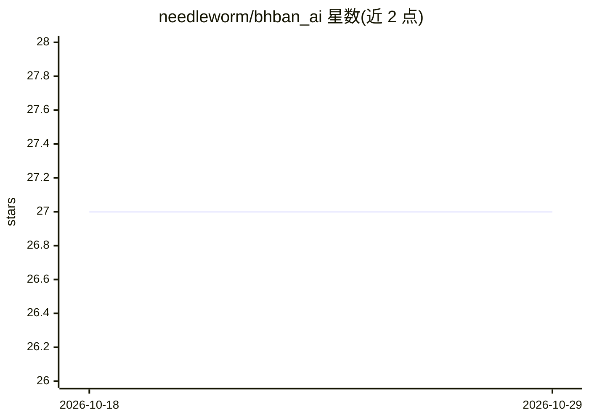

# needleworm/bhban_ai

⭐ 27 · Python · 推送 2026-10-25 · [GitHub](https://github.com/needleworm/bhban_ai) · [官网](https://needleworm.github.io/bhban_ai) · 个人维护

**韩版深度学习入门书的配套示例代码集**

《수학·통계를 몰라도 이해할 수 있는 쉬운 딥러닝》（生能出版社，2021）一书的示例代码仓库，覆盖 FNN、CNN、LSTM 等模型，并附带学习用数据与预处理器，读者可按书中内容跟随练习。面向无数学/统计基础的非专业读者与初学者，设计目标是跟随示例动手运行而非深入原理。非商业与教育用途免费（需保留作者信息），商业用途被禁止；购书读者可自由使用并制作商业程序，但收录入出版物被禁止。

## 筛选速览

| 维度 | 判定 | 备注 |
|---|---|---|
| AI 角色 | `ai-knowledge` | 知识聚合/清单类 |
| 许可风险 | `none` | — |
| 部署形态 | `None` |  |
| 模型依赖 | — | README 未给出锁定关系 |
| 硬件要求 | — | 无带数字的原话,不猜 |
| 安装摩擦 | `low` | 无编译、无系统依赖或容器化 |
| 成熟度 | — | 结构信号不足 |

## 能力要点

- 覆盖 FNN/CNN/LSTM 等深度学习模型的书籍示例代码
- 附带学习用数据与预处理器
- 面向无数学/统计背景的初学者设计

## 适用场景

- 跟随书籍章节动手运行深度学习示例
- 初学者无需数学基础入门深度学习
- 教学场景下作为课堂示例代码（需联系作者）

## 场景标签

`教程课程` · 领域:学习与行业

## 证据(README 行号)

> L4: <수학 · 통계를 몰라도 이해할 수 있는 쉬운 딥러닝 (2021, 생능출판사)> 도서에 수록될 업무 자동화 예제 코드들입니다.
> L8: 이 책은 수학이나 통계 지식이 전혀 없는 사람들을 위해 설계되었습니다. 원리를 깊게 이해할 필요 없이 여러 가지 인공지능을 현란하게 만들어 보는 것을 목표로 하고 있습니다.

## 星数曲线

2026-10-18 27 → 2026-10-29 27（+0）

---
*卡片 v1 · prompt 1.4 · 生成 2026-10-26 · 置信度 high · 依据 README sha `ad31d67eaaf7` · [字段定义](../../DATASET.md)*
