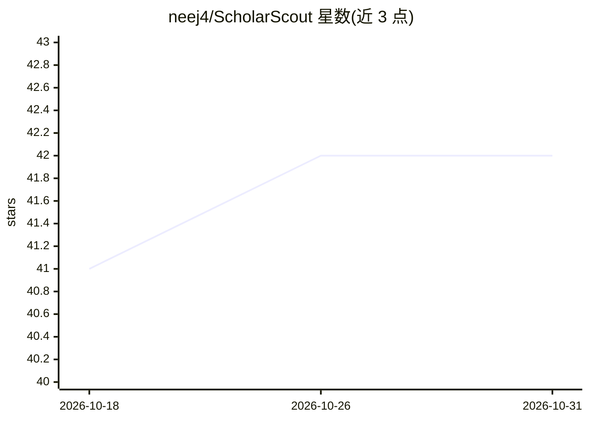

# neej4/ScholarScout

⭐ 42 · Python · MIT · 推送 2026-07-26 · [GitHub](https://github.com/neej4/ScholarScout) · [官网](https://scholarscout.pages.dev/) · 个人维护

**从 2.5 亿+ 论文中生成研究/产品/功能创意的工具**

Flask 构成的本地 Web 应用：从 arXiv、OpenAlex、Semantic Scholar、PubMed 等 8 个数据库读取 2.5 亿+ 论文，按用户目标（论文选题、产品、项目功能、文献综述）生成创意。四种模式输出不同内容：论文主题与新颖性检查、MVP 方案与竞品、基于自有代码库的功能建议、文献综述骨架。机制包括 P-number 引文反幻觉校验、证据包与 grounding 评分、语义相似度新颖性检测；LLM 通过配置的 provider（Gemini/Groq/Ollama/OpenAI 等）接入，需自备 API key 或本地模型。提供 CLI 与 dashboard，MIT 许可。

## 筛选速览

| 维度 | 判定 | 备注 |
|---|---|---|
| AI 角色 | `ai-native` | 本体是模型或模型工具 |
| 许可风险 | `permissive` | MIT |
| 部署形态 | `library` | 以包/库形式分发 |
| 模型依赖 | local-ok | 支持本地模型 |
| 硬件要求 | — | 无带数字的原话,不猜 |
| 安装摩擦 | `low` | 无编译、无系统依赖或容器化 |
| 成熟度 | — | 结构信号不足 |

## 能力要点

- 8 个数据源、80+ 类别、按学科智能路由检索
- P-number grounding 反幻觉：LLM 引文与实际抓取论文比对
- 每种创意附证据包：来源论文、主张、grounding 评分与审计标记
- 四种模式：Academic/Product/Develop/Review

## 适用场景

- 为论文或学位论文寻找可研究的问题并检查新颖性
- 基于学术趋势发现 SaaS 产品或 MVP 方向
- 为自己项目的代码库生成有论文依据的功能建议
- 把某个领域的论文组织成文献综述骨架

## 场景标签

`科研工具` · 领域:学习与行业

## 证据(README 行号)

> L5:  ScholarScout reads 250M+ academic papers from 8 databases and generates actionable ideas
> L125: |**Academic**|"What can I research?"|Thesis topics, methodology, key papers, novelty check|

## 星数曲线

2026-10-18 41 → 2026-10-31 42（+1）

---
*卡片 v1 · prompt 1.4 · 生成 2026-10-25 · 置信度 high · 依据 README sha `974f1eca3d26` · [字段定义](../../DATASET.md)*
