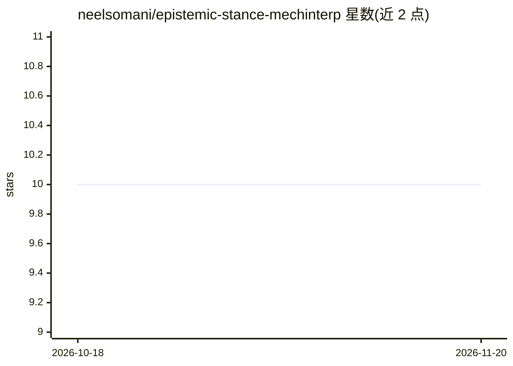

# neelsomani/epistemic-stance-mechinterp

⭐ 10 · Python · 推送 2025-12-22 · [GitHub](https://github.com/neelsomani/epistemic-stance-mechinterp) · 个人维护

**研究语言模型内部认知立场表征的可解释性实验代码库**

针对'模型能否区分声明为真与声明为假的前提'这一问题提供完整研究管线：构建受控数据集（声明真/假、X_true/X_false 四类，最小词编辑与多样模板降低格式伪影），在多个层与 token 位置记录残差流激活并训练线性探针，再做决策位点的 delta 消融干预与逐层扫描，定位行为性绑定的层带（约第 40 层）与 2–3 维立场子空间。面向机制可解释性研究者，README 附带已提交的实验结果文件。

## 筛选速览

| 维度 | 判定 | 备注 |
|---|---|---|
| AI 角色 | `ai-native` | 本体是模型或模型工具 |
| 许可风险 | `none` | — |
| 部署形态 | `library` | 以包/库形式分发 |
| 模型依赖 | — | README 未给出锁定关系 |
| 硬件要求 | — | 无带数字的原话,不猜 |
| 安装摩擦 | `low` | 无编译、无系统依赖或容器化 |
| 成熟度 | — | 结构信号不足 |

## 能力要点

- 受控数据集设计：表层内容固定、世界知识正交于认知立场
- 线性探针判别声明真/假条件并输出分层 AUROC
- 决策位点 delta 消融与逐层扫描定位因果瓶颈（约第 40 层）
- PCA 子空间分析表明立场编码于低维子空间而非单一方向

## 适用场景

- 复现前提条件推理的认知立场探测与消融实验
- 研究不同层激活的因果干预方法与层扫描流程
- 参考'均值+PCA 无中心化子空间'的消融对比设计

## 场景标签

`科研工具` · 领域:学习与行业

## 证据(README 行号)

> L7: We construct a controlled dataset of short factual statements in four classes (declared-true vs. declared-false, X_t
> L62: We record residual stream activations at multiple layers and token positions and train linear probes for three task

## 星数曲线

2026-10-18 10 → 2026-11-20 10（+0）

---
*卡片 v1 · prompt 1.4 · 生成 2026-11-19 · 置信度 mid · 依据 README sha `1ee38b06ff60` · [字段定义](../../DATASET.md)*
