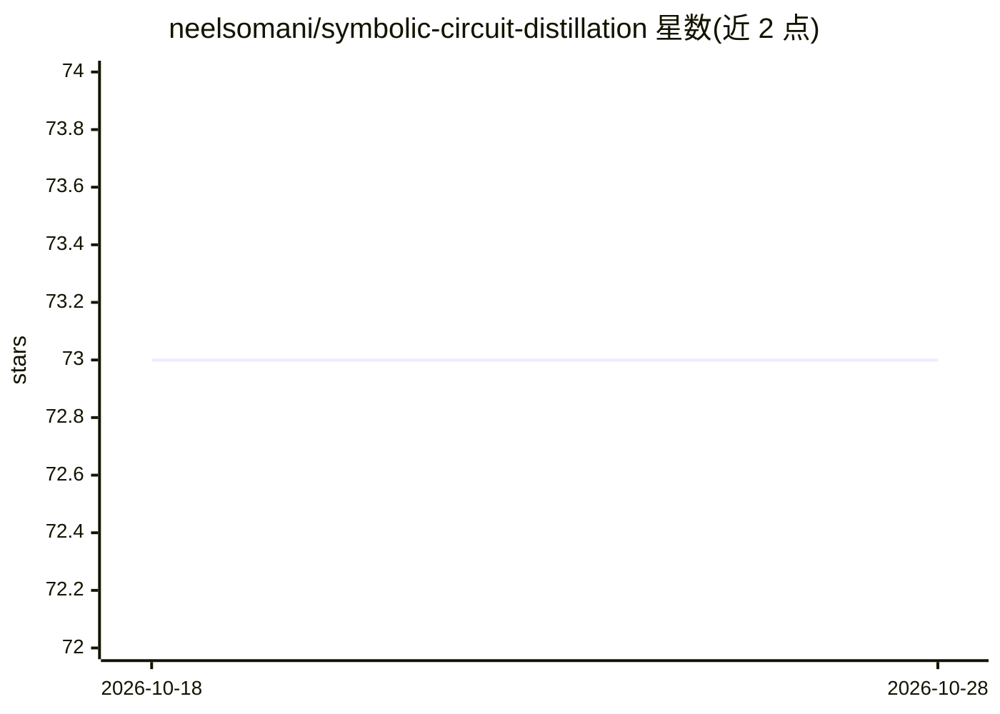

# neelsomani/symbolic-circuit-distillation

⭐ 73 · Python · Apache-2.0 · 推送 2025-11-23 · [GitHub](https://github.com/neelsomani/symbolic-circuit-distillation) · 个人维护

**从剪枝机制电路自动提取可执行程序的研究方法**

面向机制可解释性研究的方法与工具：把从稀疏模型或特征空间提取的剪枝电路视为可执行教师，先训练小规模 ReLU 代理网络在有界词元域上精确匹配电路行为，再通过模板引导的受限 DSL（计数器、开关、阈值检测、状态机等）穷举合成候选程序，最后用基于 Z3 的 SMT 有界等价性检查认证程序与代理是否等价，不等价时返回具体反例。在引号配对与括号计数等基准任务上验证，产出人类可读的类 Python 代码。明确声明不针对全规模 LLM，仅面向 5-20 节点的小型孤立电路。

## 筛选速览

| 维度 | 判定 | 备注 |
|---|---|---|
| AI 角色 | `ai-ecosystem` | LLM/agent 周边工具 |
| 许可风险 | `permissive` | Apache-2.0 |
| 部署形态 | `None` |  |
| 模型依赖 | — | README 未给出锁定关系 |
| 硬件要求 | — | 无带数字的原话,不猜 |
| 安装摩擦 | `low` | 无编译、无系统依赖或容器化 |
| 成熟度 | — | 结构信号不足 |

## 能力要点

- 剪枝电路→ReLU 代理网络→符号程序的蒸馏管线
- SMT（Z3）有界等价性检查，不等价时返回具体反例
- 模板引导 DSL 覆盖计数器、开关、状态机等常见电路模式
- 在引号配对与括号计数任务上恢复已知算法模式并暴露失效案例

## 适用场景

- 把机制可解释性研究中的小电路自动转写为可读可执行算法
- 形式化检验电路的教科书式解释是否与其精确计算一致
- 发现人工检查难以察觉的电路边缘失效行为

## 场景标签

 · 领域:AI 研究工具/可解释性

## 证据(README 行号)

> L7: We introduce Symbolic Circuit Distillation, a method for automatically converting neuron-level circuit graphs into c
> L29: This project does not attempt to interpret full-scale LLMs. Instead, we target small, well-isolated mechanistic cir
> L61: 1. **A pipeline for automatically converting mechanistic circuits into executable algorithms.**

## 星数曲线

2026-10-18 73 → 2026-10-28 73（+0）

---
*卡片 v1 · prompt 1.4 · 生成 2026-10-24 · 置信度 mid · 依据 README sha `8f935f42e012` · [字段定义](../../DATASET.md)*
