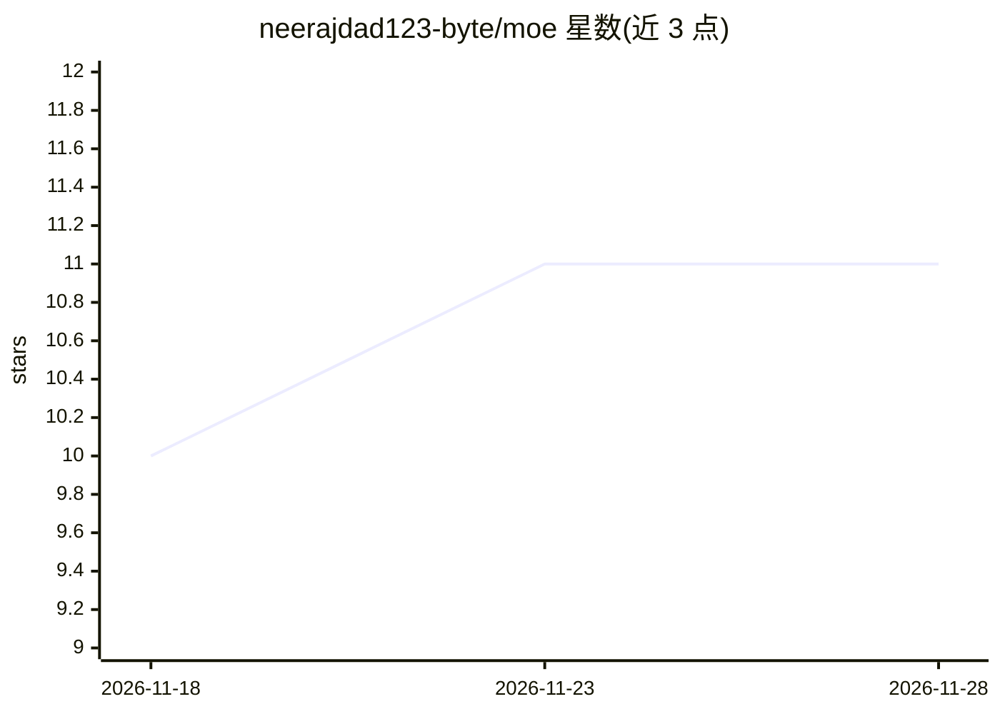

# neerajdad123-byte/moe

⭐ 11 · Cuda · MIT · 推送 2026-11-01 · [GitHub](https://github.com/neerajdad123-byte/moe) · 个人维护

**在 6GB 笔记本 GPU 上以约 68 tok/s 运行 Qwen3.6-35B MoE 的本地推理运行时**

面向 Windows/Linux 桌面的本地 LLM 推理引擎，针对 Qwen3.5/3.6-35B-A3B 类 MoE 模型做专家级显存缓存、CPU 卸载与多 token 预测（MTP）。通过 moex download 从 Hugging Face 获取模型，moex chat 在终端对话，moex serve 提供 OpenAI 兼容 API，moex import 可将已有 GGUF（llama.cpp/LM Studio/Ollama 下载的）一次性转换后运行。仅需 NVIDIA 驱动，无需 CUDA 工具包与 Python；提供 installer/zip/Linux 安装脚本与源码构建。README 称其在无投机解码对比下约 1.9x 调优 llama.cpp/ik_llama.cpp。

## 筛选速览

| 维度 | 判定 | 备注 |
|---|---|---|
| AI 角色 | `ai-ecosystem` | LLM/agent 周边工具 |
| 许可风险 | `permissive` | MIT |
| 部署形态 | `desktop` | 安装包/桌面程序 |
| 模型依赖 | — | README 未给出锁定关系 |
| 硬件要求 | — | 无带数字的原话,不猜 |
| 安装摩擦 | `medium` | 含编译或系统依赖之一 |
| 成熟度 | — | 结构信号不足 |

## 能力要点

- 专家级 VRAM 缓存 + CPU 卸载，6GB 显存笔记本 GPU 运行 35B MoE 模型
- 多 token 预测（MTP）解码，默认开启
- moex serve 提供 OpenAI 兼容 API，moex import 转换已有 GGUF
- FlashAttention-2 prefill、prompt checkpoints、TurboQuant KV 缓存等可配置项

## 适用场景

- 在低显存笔记本上本地运行 35B MoE 模型对话
- 为其他应用提供 OpenAI 兼容的本地 API 服务
- 把已下载的 llama.cpp/Ollama GGUF 模型转换后加速运行
- 用 moex bench 测量本机推理速度

## 场景标签

`推理引擎` · 领域:训练与推理

## 证据(README 行号)

> L3: **Run Qwen3.6-35B-A3B at 68 tokens/s on a 6 GB laptop GPU.**
> L130: |`moex serve`|OpenAI-compatible API for other apps|
> L158: Already downloaded a GGUF for llama.cpp, LM Studio or Ollama? Convert it once, then run it like the default model:

## 星数曲线

2026-11-18 10 → 2026-11-28 11（+1）

---
*卡片 v1 · prompt 1.4 · 生成 2026-11-19 · 置信度 mid · 依据 README sha `8a94b7d45a82` · [字段定义](../../DATASET.md)*
