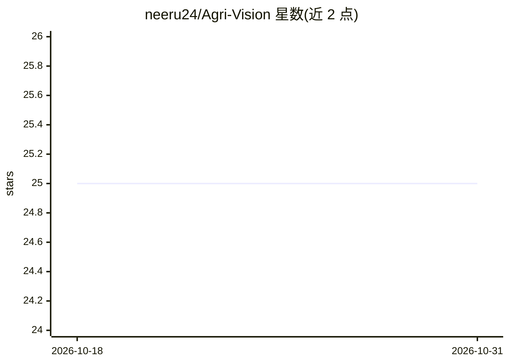

# neeru24/Agri-Vision

⭐ 25 · Jupyter Notebook · MIT · 推送 2026-08-27 · [GitHub](https://github.com/neeru24/Agri-Vision) · [官网](https://agri-vision-3.onrender.com/) · 个人维护

**面向棉农与科研者的棉花图像生长阶段与病害检测系统**

基于深度学习与计算机视觉的作物图像分析系统：用户上传棉花（另含番茄、马铃薯部分能力）照片，系统用 YOLOv8 检测 5 个生长阶段、用 ResNet50 分类蚜虫、细菌性枯萎病等 8 类健康状况，输出置信度、管理建议与结合 OpenWeather 天气数据的产量估计，并提供 Grad-CAM 热力图解释。以 Flask Web 界面与 REST API 交付，支持 Docker 或本地 Python 运行。训练数据来自 Roboflow 与 Kaggle 公开数据集。

## 筛选速览

| 维度 | 判定 | 备注 |
|---|---|---|
| AI 角色 | `ai-native` | 本体是模型或模型工具 |
| 许可风险 | `permissive` | MIT |
| 部署形态 | `self-host` | docker 或自建部署 |
| 模型依赖 | — | README 未给出锁定关系 |
| 硬件要求 | — | 无带数字的原话,不猜 |
| 安装摩擦 | `low` | 无编译、无系统依赖或容器化 |
| 成熟度 | — | 结构信号不足 |

## 能力要点

- YOLOv8 生长阶段检测（棉花 mAP50 60.06%，推理 3.3ms）
- ResNet50 病害分类（棉花准确率 99.83%），附 Grad-CAM 可视化
- 结合 OpenWeather 天气数据的产量估计与建议
- Flask Web 界面 + REST API，Docker 一键运行

## 适用场景

- 上传棉花照片判断生长阶段与病害并获取管理建议
- 通过 REST API 程序化集成作物分析能力
- 农场结合天气数据估计产量与收获时机

## 场景标签

`目标检测` · 领域:感知与多模态

## 证据(README 行号)

> L3: Agri-Vision is an AI-powered system that analyzes cotton crop images to determine growth stages and health condition
> L28: - Detect cotton growth phases
> L29: - Identify cotton crop diseases

## 星数曲线

2026-10-18 25 → 2026-10-31 25（+0）

---
*卡片 v1 · prompt 1.4 · 生成 2026-10-27 · 置信度 mid · 依据 README sha `443b1c0fd4b0` · [字段定义](../../DATASET.md)*
