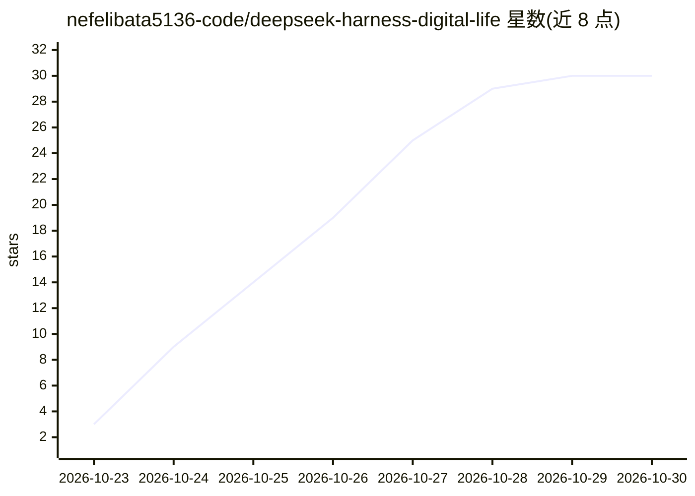

# nefelibata5136-code/deepseek-harness-digital-life

⭐ 30 · JavaScript · MIT · 推送 2026-10-20 · [GitHub](https://github.com/nefelibata5136-code/deepseek-harness-digital-life) · 个人维护 · 中文 README

**基于 DeepSeek Harness 的多 agent 持久数字生命实验性基础设施**

在原生 DeepSeek Harness（固定 0.2.0-rc.2）之上构建的多 agent 长期运行基础设施：提供稳定 lifeId 身份与独立 life worker、owner 绑定的私有空间（Core/工作区/Memory/Vault）、中立的共享 World（Supervisor、心跳、启停控制，World 自身不发起模型请求）、持久化通信（私聊、agent 间消息、Rooms、收据）、记忆与恢复机制、后台委托任务。通过官方 DeepSeek Adapter 接入模型，声明为实验性项目，上游 DSH 处于 developer preview、API 演进中，需 API 付费。

## 筛选速览

| 维度 | 判定 | 备注 |
|---|---|---|
| AI 角色 | `ai-ecosystem` | LLM/agent 周边工具 |
| 许可风险 | `permissive` | MIT |
| 部署形态 | `None` |  |
| 模型依赖 | locked-api |  |
| 硬件要求 | — | 无带数字的原话,不猜 |
| 安装摩擦 | `low` | 无编译、无系统依赖或容器化 |
| 成熟度 | `idea` | |

## 能力要点

- 稳定 lifeId 身份、独立 life worker 与 owner 绑定的 Session 所有权
- 持久通信：人类私聊、agent 间消息、Rooms、收据与时间线
- 中立共享 World（Supervisor/心跳/启停），World 自身不发起模型请求
- 记忆基础设施、Schedule 唤醒、上下文检查点与状态恢复

## 适用场景

- 实验多个 agent 长期自主运行与协作的数字生命系统
- 为持久 agent 搭建私有空间、记忆与可恢复的连续性
- 研究 agent 间社交、共享世界与委托任务机制

## 场景标签

`多智能体` `Agent 记忆` · 领域:Agent 开发

## 证据(README 行号)

> L31: This repository builds an experimental foundation on native DeepSeek Harness:
> L227: `deepseek-harness-digital-life` is **an experimental foundation for persistent
> L237: The current v0.2.0 source implements:

## 星数曲线

2026-10-23 3 → 2026-10-30 30（+27）

---
*卡片 v1 · prompt 1.4 · 生成 2026-10-27 · 置信度 high · 依据 README sha `76ec5a925169` · [字段定义](../../DATASET.md)*
